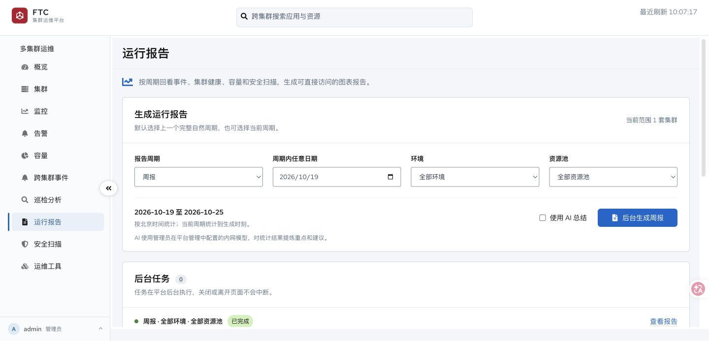

# Kubernetes 多集群管理平台

> 当前发布版本：`v1.1.0`

一个参考 CNCF Headlamp 技术架构、聚焦集群稳定性的轻量多集群管理平台。



> FTC 集群运维平台：统一入口查看多集群状态、监控告警、容量、跨集群事件、安全扫描和运行报告。

**功能说明见 [`docs/product/features.md`](docs/product/features.md)**：按运维能力域组织，说明每个功能解决什么问题、关键概念、操作流程，以及数据来源与限制（含「面板为空为什么不是 Bug」这类边界）。

## 技术栈

- Go 后端
- React + TypeScript 前端
- PatternFly 6（ACM 风格）
- Kubernetes `client-go` v0.32.x
- SQLite（本地开发）
- MySQL 8.4（生产环境统一存储）

## 当前开发状态

项目已包含真实集群纳管、健康概览、全局资源池容量、单集群容量基线、节点、工作负载、Pod 详情与日志，以及单集群 Event 中心。Event 由平台通过 Kubernetes API `List + Watch` 非侵入式采集，按 UID 更新重复次数；Warning 保留 30 天，Normal 保留 7 天，小时聚合保留 365 天；24 小时以上窗口优先读取按天/对象/类别生成的日聚合。

平台最终以 Web 服务形式部署到 Kubernetes，不开发桌面端，也不要求用户单独运行客户端程序。

### 手动安全扫描

管理员可在一级“安全扫描”页面选择一套或多套集群手动执行完整扫描：节点侧 kube-bench 临时 Job + 集群侧只读 API 检查（Pod 安全上下文、RBAC、Service 暴露面、NetworkPolicy）。平台结束后回收 Job 并持久化报告；同一集群再次扫描时，页面对比最近两次成功结果，标注整改成功、未整改和新增风险；不合规项可按集群加入带原因的白名单，豁免项不再计入失败和得分。详见 [`docs/deployment/kubernetes.md`](docs/deployment/kubernetes.md#手动安全扫描与权限)。

### 跨集群资源索引

平台在自身数据库中维护 `cluster_resources` 摘要表，由 Leader 每 10 分钟刷新一套集群。浏览器搜索只查询该索引，不再访问目标集群；索引完全为空时才回退到一次受控的实时加载。可通过 `RESOURCE_INDEX_INTERVAL`、`RESOURCE_INDEX_TIMEOUT` 和 `RESOURCE_INDEX_WORKERS` 调整刷新周期、单集群超时和并发。

### 多集群健康快照

集群列表和全局概览读取平台数据库中的最近健康快照，不会因页面刷新而同时扫描所有集群。后台采集器默认每 60 秒错峰刷新一轮，最多同时检查 5 套集群，单集群检查超时为 20 秒；某套集群失败只会将该集群标记为连接失败，并保留上一次成功指标及检查时间。

可通过 `HEALTH_COLLECTION_INTERVAL`、`HEALTH_COLLECTION_WORKERS` 和 `HEALTH_COLLECTION_TIMEOUT` 调整采集周期、并发上限和单集群超时。设置 `HEALTH_INSTANCE_SOURCE=workloads` 后，实例数来自 Deployment/StatefulSet/DaemonSet 状态，健康采集只列 kube-system Pod，不再每分钟全量读取业务 Pod；`deploy/platform.yaml` 默认启用该模式。60 套集群建议先保持 `1m / 5 / 20s`，经过压测后再调高并发。

集群概览与容量默认读取采集快照，只有显式刷新才实时访问目标集群；节点、工作负载、Pod 日志和 Exec 仍按需实时访问。跨集群事件的问题与对象视图在数据库内完成聚合，只有单个资源的证据查询才读取原始 Event。跨集群搜索读取平台持久化资源索引，由 Leader 每 10 分钟刷新一轮，浏览器搜索不再访问目标集群；索引为空时回退到受控的实时加载。

当前 SQLite 方案面向单副本第一阶段；生产多副本前需迁移到共享 MySQL，并为后台采集器增加 Leader Election。详细决策见 [`docs/adr/0002-cache-fleet-health-snapshots.md`](docs/adr/0002-cache-fleet-health-snapshots.md)。

面向 100 套集群与 10 人并发运维的承载架构（资源隔离、采集分片、实时操作预算、压测与验收口径）见 [`docs/adr/0009-fleet-collection-architecture-at-scale.md`](docs/adr/0009-fleet-collection-architecture-at-scale.md)。

## 本地工具

当前开发机使用 Homebrew 安装的 macOS ARM 版 Go。若终端优先找到旧的 `/usr/local/go/bin/go`，先执行：

```bash
export PATH="/opt/homebrew/bin:$PATH"
```

运行基础验证：

```bash
make test
cd web && npm run build && npm run lint
```

启动后端前，需要提供开发用配置：

```bash
export ADMIN_PASSWORD_HASH="仅限本地学习的占位值"
export CREDENTIAL_ENCRYPTION_KEY="仅限本地学习的占位值"
make dev-backend
```

Pod Exec 在本地开发和 Kubernetes 新部署中默认开启。如需临时禁用，使用 `ENABLE_POD_EXEC=false make dev-backend` 或在部署配置中显式设为 `false`。

本地开发不设置 `PLATFORM_DATABASE_DSN` 时全部数据保存到 SQLite。`deploy/mysql.yaml` 仅用于本地/单副本开发，不是交付版高可用方案。

Kubernetes 交付使用单一清单、平台自身 HTTPS 和 NodePort，无需 Ingress，也不需要生成私有清单或填写初始化 Token。执行 `kubectl apply -f deploy/install.yaml` 后打开 `https://<节点IP>:30080`，页面会自动预检；完成初始化后通过 `https://<自定义域名>:30443` 使用平台。MySQL 是必需的外部依赖，部署清单不会在集群内创建 MySQL 或 PVC。详见 [`docs/deployment/install.md`](docs/deployment/install.md)。

后端启动后，可访问健康检查接口：

```text
GET http://127.0.0.1:8080/api/v1/health
GET http://127.0.0.1:8080/api/v1/version
```

启动前端：

```bash
make dev-frontend
```

整体产品与架构基线见 [`docs/product/2026-10-15-multi-cluster-operations-platform-requirements.md`](docs/product/2026-10-15-multi-cluster-operations-platform-requirements.md)。

历史模块设计与开发步骤位于 [`docs/plans`](docs/plans)。

Kubernetes 本地开发资料见 [`docs/deployment/kubernetes.md`](docs/deployment/kubernetes.md)；新环境交付按 [`docs/deployment/install.md`](docs/deployment/install.md) 执行。

三节点 Kind 本地验收环境、AMD64/ARM64 离线镜像打包与部署步骤见 [`deploy/kind/README.md`](deploy/kind/README.md)。

设置 `METRICS_ADDR`（例如 `:9090`）后，平台在独立端口暴露 Prometheus 文本指标：采集轮次/错误/耗时、事件 List/Watch 重连、API 请求量与 5xx、托管集群数。该端口不经过登录认证，生产环境只应通过内网 Service 或 NetworkPolicy 暴露。

### Arthas 离线诊断

Arthas 4.3.5 完整发行包随平台二进制内置，经 Kubernetes Exec 传入目标容器，不依赖容器出网或新增 Service。支持 Linux x86_64 / ARM64；目标需 JDK8+、sh、tar、可写 `/tmp`，并与 JVM 同用户运行。详细来源与校验信息见 `internal/arthasdist/README.md`。
平台管理的 Java 排障参数默认使用该内置版本；只有管理员需要升级时，才配置内网 HTTP/HTTPS 完整 ZIP 离线包地址、版本和可选 SHA-256。平台下载校验后经 Exec 传入 Pod，目标容器仍无需出网。

运维工具中先选集群、命名空间、Pod 和容器，再启动会话。故障向导默认折叠，内置社区用户排障案例。test01 的 myapp 已部署 arthas-demo，构建与复现方式见 `deploy/examples/arthas-demo/README.md`。

### 运行报告

一级“运行报告”页面可按自然周、自然月或自然季度生成报告，并按环境与 G01/OCP 资源池筛选。报告只读取数据库中已保存的 Event 小时聚合、安全扫描记录和生成时最新健康/容量快照，不会同时请求所有纳管集群。

生成结果以平台内的独立 HTML 图表页保存，支持页内预览、新窗口打开和复制直达链接，访问仍需登录平台。不配置模型也可生成事实图表与规则建议；管理员可选配置内网 OpenAI Chat Completions 兼容接口进行 AI 总结，API Key 加密保存且不在页面回显。模型不可用时，已聚合的事实报告仍会保留。

如需查看不污染数据库的高数据量演示页，执行 `go run ./cmd/reportdemo`，结果位于 `data/demo/operational-report-v1.html`。

## 集群规模与验证

100 集群／10 用户承载改造采用 API、Collector、Worker 角色隔离，共享数据库分片租约与写入 fencing，分页采集与跨副本有界配额。启用配置和迁移约束见 [`docs/deployment/kubernetes.md`](docs/deployment/kubernetes.md)。

`cmd/fleetscale` 可运行独立 TLS endpoint 的大对象量模拟。已实施范围、短时实测与未验收项见 [`docs/performance/2026-10-21-fleet-100-synthetic.md`](docs/performance/2026-10-21-fleet-100-synthetic.md)。模拟结果不等同于真实 100 集群／24 小时生产验收。
