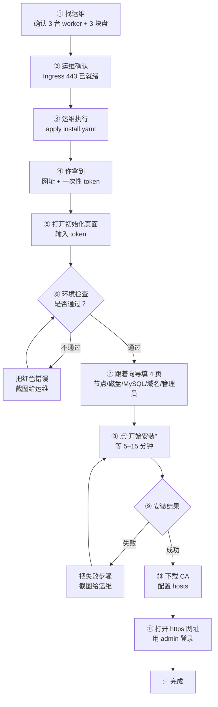
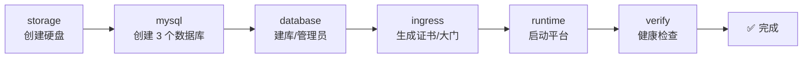
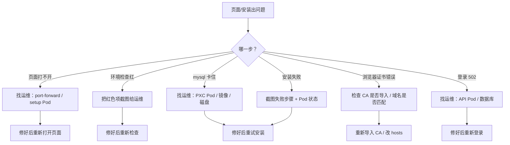

# FTC 平台安装：小白版

> **这一版是给第一次接触 Kubernetes 的人看的。**
>
> 不需要懂 Helm，不需要懂 Operator，也不需要背命令。你只要按图一步一步做，看到“✅ 通过”再进入下一步。
>
> 更完整的命令、参数和排错手册在 [运维详细版](install.md)。

> **注意：安装清单不会自动安装 ingress-nginx。** ingress-nginx 是平台的“大门”，需要运维提前准备好；如果集群里没有，环境检查会失败。具体见第 5 节。

---

## 0. 先看：你最后会得到什么

安装完成后，你会得到：

```text
一个内部网址：https://ftc-platform.cmb.local
一个管理员账号：admin
一个三节点 MySQL：3 个数据库副本互相备份
一个 HTTPS 证书：浏览器地址栏不再报错
```

你不需要自己装 MySQL，也不需要自己配主从。安装向导会帮你创建。

---

## 1. 开始前，只需要准备 5 样东西

把下面这张表拿给运维，让他帮你确认。**5 项都打勾才能开始。**

| 需要的东西 | 通俗解释 | 找谁要 | 打勾 |
| --- | --- | --- | --- |
| 3 台 worker 机器 | 运行平台的服务器；不是 3 台随便的机器，要能跑 Kubernetes | 运维 | [ ] |
| 每台一块数据盘 | 给 MySQL 存数据，建议每台 200GiB | 运维 | [ ] |
| 一个内部域名 | 例如 `ftc-platform.cmb.local` | 运维/网络 | [ ] |
| 一个能打开的 443 入口 | 就是 ingress-nginx，平台的“大门” | 运维 | [ ] |
| 一个管理员密码 | 至少 12 位，建议 16 位以上 | 你自己定 | [ ] |

> **重要：** 这 3 台是 **worker**，不要用 3 台 control-plane 凑数。PXC 的三个数据库副本需要分别落在 3 台可调度的机器上。

---

## 2. 整体流程图



**一句话：**

```text
运维准备机器和入口 → 运维执行安装清单 → 你拿 token 打开网页
→ 环境检查 → 点 4 页向导 → 等安装 → 装 CA → 登录
```

---

## 3. 你只需要做 6 件事

| 你要做的 | 大概花多久 | 需要命令吗 |
| --- | --- | --- |
| 1. 找运维确认 3 台机器、3 块盘、域名、Ingress | 10 分钟 | 不需要 |
| 2. 让运维执行 `install.yaml`，把 token 给你 | 5–10 分钟 | 运维执行 |
| 3. 打开初始化页面，输入 token | 1 分钟 | 可能需要一条 port-forward |
| 4. 在向导里填 4 页 | 5 分钟 | 不需要 |
| 5. 点“开始安装”，等结果 | 5–15 分钟 | 不需要 |
| 6. 下载 CA、配 hosts、登录 | 5 分钟 | 需要改一次 hosts |

> 如果运维已经帮你把页面打开，你只需要做第 3–6 步。

---

## 4. 第 1 步：确认机器和磁盘

### 你要看到的

让运维给你下面这些信息，填到表里：

| 信息 | 示例 | 你的值 |
| --- | --- | --- |
| 节点 1 | `prod-worker-01` |  |
| 节点 2 | `prod-worker-02` |  |
| 节点 3 | `prod-worker-03` |  |
| MySQL 路径 | `/data/ftc-platform/mysql` |  |
| 每台容量 | `200Gi` |  |
| 内部域名 | `ftc-platform.cmb.local` |  |
| IngressClass | `nginx` |  |

### 让运维执行的确认命令

```bash
kubectl get nodes -o wide
kubectl get ingressclass
```

### ✅ 通过标准

- 能看到 **3 个可调度 worker**；
- 每台机器有独立数据盘；
- 能看到一个 IngressClass（通常是 `nginx`）。

### ❌ 如果不对

把 `kubectl get nodes` 和 `kubectl get ingressclass` 的输出截图给运维，不要自己改节点。

---

## 5. 第 2 步：确认“大门”已经打开

平台需要一个“大门”把浏览器请求转进来，这个大门叫 **Ingress**。

### 你只需要问运维一句话

```text
我们的 ingress-nginx 装好了吗？
用哪个 IngressClass？
浏览器访问 443 能通吗？
```

### 让运维验证

```bash
kubectl get ingressclass
curl -kI https://<节点IP或VIP>/
```

### ✅ 通过标准

- IngressClass 有名字（例如 `nginx`）；
- `curl -kI` 能返回 `HTTP/2 404` 或 `200`，不是 `connection refused`；
- 运维确认用户网段能访问 443。

### ❌ 如果不对

把“没有 IngressClass”或“connection refused”的截图给运维。**这一步不能跳过**，否则后面网页打不开。

---

## 6. 第 3 步：让运维执行安装清单

这一步是运维做的，你只需要拿到 **3 个东西**：

1. 初始化页面的地址（通常是 `http://127.0.0.1:8080`）；
2. 一次性 `setup token`；
3. 后面要用的 CA 文件（安装完成后才有）。

### 运维执行（你不需要做）

```bash
# 1. 替换平台镜像地址
cp deploy/install.yaml /tmp/ftc-install.yaml
sed -i 's|REPLACE_WITH_PLATFORM_IMAGE|registry.example.com/ftc/ftc-platform:0.1.0|g' /tmp/ftc-install.yaml

# 2. 应用清单
kubectl apply -n ftc-platform -f /tmp/ftc-install.yaml

# 3. 等初始化 Job 完成
kubectl -n ftc-platform wait --for=condition=complete job/ftc-platform-bootstrap --timeout=15m

# 4. 读取一次性 token
kubectl -n ftc-platform get secret ftc-platform-bootstrap \
  -o jsonpath='{.data.setup-token}' | base64 -d; echo

# 5. 打开初始化页面（在能连集群的机器上执行）
kubectl -n ftc-platform port-forward svc/ftc-platform-setup 8080:80
```

### 你要拿到的

```text
页面地址：http://127.0.0.1:8080
setup token：一串 32 位字母数字
```

### ✅ 通过标准

- 运维说“bootstrap Job 完成了”；
- 你拿到了 token；
- 浏览器能打开 `http://127.0.0.1:8080`。

### ❌ 如果不对

| 现象 | 找谁 |
| --- | --- |
| 页面打不开 | 运维，检查 port-forward/setup Pod |
| token 是空的 | 运维，检查 bootstrap Job 日志 |
| 页面 404 | 运维，确认平台镜像版本 |

---

## 7. 第 4 步：打开初始化页面

在浏览器里打开运维给你的地址：

```text
http://127.0.0.1:8080
```

你看到的页面大概长这样：

```text
┌──────────────────────────────────────────────────────────┐
│  FTC 平台初始化                                          │
│                                                          │
│  ① 环境检查   ② 数据库与存储   ③ 访问配置   ④ 确认安装  │
│                                                          │
│  初始化凭证（setup token）                               │
│  ┌────────────────────────────────────────────────────┐  │
│  │ 请输入运维提供的一次性 token                       │  │
│  └────────────────────────────────────────────────────┘  │
│                                                          │
│  [ 检查环境 ]                                            │
└──────────────────────────────────────────────────────────┘
```

把运维给你的 token 粘贴进去，点 **“检查环境”**。

> token 是一次性的，不要发到群里，不要写进文档。

---

## 8. 第 5 步：环境检查（Preflight）

### 你会看到

页面会列出一组检查项：

```text
✅ 可调度节点：3 个
✅ 节点架构：arm64 / amd64
✅ IngressClass：nginx
✅ PXC CRD：存在
✅ 运行 Secret：不存在
```

### 你要做的

- 全是 ✅ → 点“下一步”；
- 有 ❌ → **不要继续**，把红色部分截图给运维。

### 常见红色项

| 红色提示 | 让运维做什么 |
| --- | --- |
| 可调度节点少于 3 | 加 worker，或去掉 control-plane 污点 |
| IngressClass 不存在 | 安装/修复 ingress-nginx |
| PXC CRD 不存在 | 重新 apply 完整 `install.yaml` |
| 已经初始化过 | 确认是否已有平台；不要重复装 |

> 如果页面提示“已经初始化”，**不要继续点**，先让运维确认是不是已经装过一套。

---

## 9. 第 6 步：跟着向导填 4 页

### 第 1 页：数据库与存储

```text
节点 1  [prod-worker-01 ▼]   路径 [/data/ftc-platform/mysql]   容量 [200] GiB
节点 2  [prod-worker-02 ▼]   路径 [/data/ftc-platform/mysql]   容量 [200] GiB
节点 3  [prod-worker-03 ▼]   路径 [/data/ftc-platform/mysql]   容量 [200] GiB

MySQL 镜像：
  Operator  [registry.../percona-xtradb-cluster-operator:1.18.0]
  PXC       [registry.../percona-xtradb-cluster:8.0.42-33.1]
  HAProxy   [registry.../percona-haproxy:2.8.15]
  拉取 Secret [ftc-platform-registry]
```

怎么填：

- 三个节点必须选 **不同** 的 worker；
- 三个路径可以一样（因为不在同一台机器上）；
- 容量建议 `200Gi`，最低 `100Gi`；
- 镜像和 Secret 让运维给你，照着粘贴。

### 第 2 页：访问配置

```text
内部域名       [ftc-platform.cmb.local]
IngressClass   [nginx]
管理员用户名   [admin]
管理员密码     [••••••••••••]
确认密码       [••••••••••••]
```

怎么填：

- 域名不要带 `https://`，也不要带路径；
- IngressClass 必须和第 2 步看到的一致；
- 密码至少 12 位，建议 16 位以上，记到密码管理器。

### 第 3 页：确认安装

页面会汇总你填的内容。检查：

- [ ] 3 个节点没选错；
- [ ] 3 个路径没写错；
- [ ] 容量够；
- [ ] 域名正确；
- [ ] 管理员密码记住了。

确认后点 **“开始安装”**。

---

## 10. 第 7 步：安装中，你只需要等

### 你会看到的阶段



| 阶段 | 大概时间 | 你可以做什么 |
| --- | --- | --- |
| storage | <1 分钟 | 等 |
| mysql | 5–15 分钟 | 等；不要刷新页面 |
| database | 1–3 分钟 | 等 |
| ingress | <1 分钟 | 等 |
| runtime | 1–2 分钟 | 等 |
| verify | 1–5 分钟 | 等 |

### 千万不要做

- ❌ 不要关浏览器；
- ❌ 不要重复点“开始安装”；
- ❌ 不要自己去删 Pod/PVC；
- ❌ 不要去改数据库副本数；
- ❌ 不要重启 setup Pod（进度会丢）。

### 如果失败了

把失败的那一步截图给运维，并附上：

```bash
kubectl -n ftc-platform get pods
kubectl -n ftc-platform get events --sort-by=.lastTimestamp | tail -30
```

不要直接“重装”。

---

## 11. 第 8 步：安装成功后，做 3 件事

### ① 下载 CA

结果页会有“下载 CA”按钮。把文件保存为：

```text
ftc-platform-ca.crt
```

### ② 配置 hosts

如果公司没有内部 DNS，需要在自己电脑上加一行。

macOS/Linux：

```bash
sudo sh -c 'echo "10.20.30.11  ftc-platform.cmb.local" >> /etc/hosts'
```

Windows：

```text
用记事本以管理员身份打开：
C:\Windows\System32\drivers\etc\hosts
加入：
10.20.30.11  ftc-platform.cmb.local
```

> IP 用运维给你的 VIP 或节点 IP；不要随便写。

### ③ 导入 CA 并登录

macOS：

```bash
sudo security add-trusted-cert -d -r trustRoot \
  -k /Library/Keychains/System.keychain ftc-platform-ca.crt
```

Windows：

```text
双击 ftc-platform-ca.crt → 安装证书 → 受信任的根证书颁发机构
```

然后打开：

```text
https://ftc-platform.cmb.local
```

用你刚才设置的管理员账号登录。

---

## 12. 怎么判断“真的装好了”

不要只看页面有没有“完成”，对照下面 5 个勾：

| 检查 | 你应该看到 | 没看到怎么办 |
| --- | --- | --- |
| 数据库 | 3 个 PXC Running；HAProxy 至少 2/3 | 截图给运维 |
| 硬盘 | 3 个 PVC 都是 Bound | 截图给运维 |
| 大门 | Ingress 有 TLS，域名正确 | 检查 IngressClass/hosts |
| 平台 | API/Collector/Worker 都是 Running | 看 Pod 日志 |
| 登录 | 浏览器无证书警告，admin 能登录 | 检查 CA/hosts/密码 |

让运维执行：

```bash
kubectl -n ftc-platform get pods,pvc,ingress
kubectl -n ftc-platform get pxc platform-mysql
```

### ✅ 全部通过

```text
PXC 3/3
HAProxy 3/3（至少 2/3）
PVC 3/3 Bound
Ingress 有 TLS
admin 能登录
```

---

## 13. 出错了，先看这张图



### 最常见的 6 个问题

| 你看到的 | 大概原因 | 你该做什么 |
| --- | --- | --- |
| `http://127.0.0.1:8080` 打不开 | port-forward 断了 | 让运维重新执行 port-forward |
| token 错误 | 复制多了空格/换行 | 重新复制，不要手打 |
| 环境检查说节点不够 | 只有 2 个可调度 worker | 找运维加节点 |
| 卡在 mysql 很久 | 镜像拉取慢/磁盘不足 | 找运维看 PXC Pod |
| 浏览器提示证书不安全 | CA 没导入/域名不对 | 导入 CA，确认域名一致 |
| 登录 502 | API 没起来/数据库连不上 | 找运维看 API 日志 |

---

## 14. 这 6 件事不要做

- ❌ 不要把 setup token 发到微信群/邮件；
- ❌ 不要把 `encryption-key` 弄丢（丢了以后已纳管集群的 kubeconfig 解不开）；
- ❌ 不要在安装中刷新/关闭浏览器；
- ❌ 不要重复安装；
- ❌ 不要手工删 PXC 的 PVC/PV；
- ❌ 不要把 443 直接暴露到公网而不加限制。

---

## 15. 一页纸命令卡（给运维/进阶用户）

```bash
# 1. 看节点和 Ingress
kubectl get nodes -o wide
kubectl get ingressclass

# 2. 应用安装清单
cp deploy/install.yaml /tmp/ftc-install.yaml
sed -i 's|REPLACE_WITH_PLATFORM_IMAGE|registry.example.com/ftc/ftc-platform:0.1.0|g' /tmp/ftc-install.yaml
kubectl apply -n ftc-platform -f /tmp/ftc-install.yaml

# 3. 等 Job 并取 token
kubectl -n ftc-platform wait --for=condition=complete job/ftc-platform-bootstrap --timeout=15m
kubectl -n ftc-platform get secret ftc-platform-bootstrap \
  -o jsonpath='{.data.setup-token}' | base64 -d; echo

# 4. 打开初始化页
kubectl -n ftc-platform port-forward svc/ftc-platform-setup 8080:80

# 5. 安装后检查
kubectl -n ftc-platform get pods,pvc,ingress
kubectl -n ftc-platform get pxc platform-mysql

# 6. 取 CA
kubectl -n ftc-platform get secret ftc-platform-ca \
  -o jsonpath='{.data.ca\.crt}' | base64 -d > ftc-platform-ca.crt
```

> 更完整的资源规划、失败处理、升级/备份/卸载，请看 [运维详细版](install.md)。

---

## 16. 术语小抄

| 词 | 你可以理解成 |
| --- | --- |
| Namespace | 一个文件夹，平台的东西都放在 `ftc-platform` 里 |
| Pod | 一个正在运行的小程序 |
| PVC/PV | 硬盘申请/真正的硬盘 |
| Ingress | 平台的“大门”，把浏览器请求转进来 |
| IngressClass | 大门的管理员名字，通常是 `nginx` |
| PXC | MySQL 的三副本集群，一个坏了还有两个 |
| HAProxy | MySQL 的“前台”，把请求转给可用的数据库 |
| CA | 证明“这个网站是可信的”的证书 |
| setup token | 一次性安装钥匙，装完就失效 |
| encryption key | 加密钥匙，丢了已纳管集群的 kubeconfig 解不开 |

---

## 17. 最后：什么时候必须找运维

出现以下任一情况，不要自己处理：

- 没有 3 个可调度 worker；
- 没有独立数据盘；
- `kubectl get ingressclass` 为空；
- 443 访问不了；
- 镜像拉取失败；
- PXC 不是 3/3；
- 安装失败但看不懂日志；
- 需要删除/重建 PV、PVC、PXC。

把这些信息发给运维：

```text
1. 安装到哪一步失败（截图）
2. kubectl -n ftc-platform get pods 的输出
3. kubectl -n ftc-platform get events --sort-by=.lastTimestamp | tail -30
4. 使用的域名和 IngressClass
```

---

**相关文档：**

- [运维详细版](install.md)：完整命令、资源清单、失败处理、升级/备份/卸载
- [平台 README](../../README.md)
