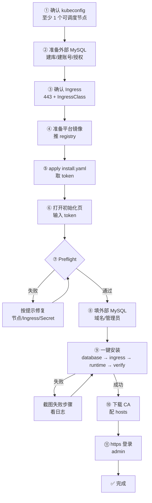
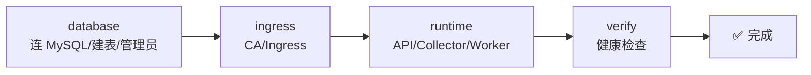
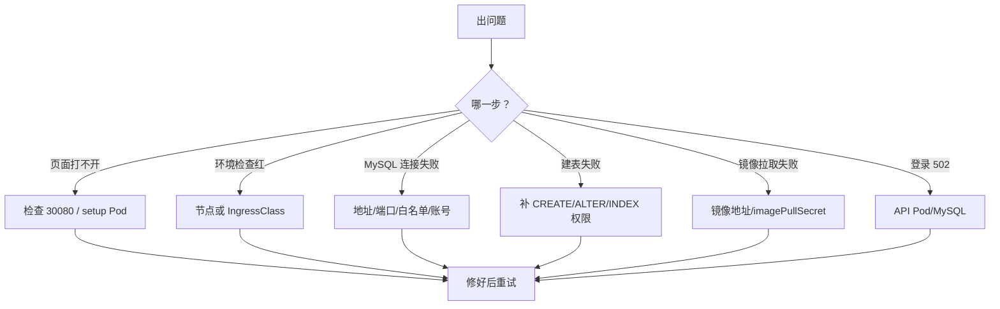

# FTC 平台安装：一个人也能完成（外部 MySQL 版）

> **这一版的目标：一个人、一个 kubeconfig、一个外部 MySQL，就能装完。**
>
> 不需要 Helm，不需要 PXC，不需要 3 台 worker，也不需要给 MySQL 准备本地盘。
> 你只要按图一步一步做，看到“✅ 通过”再进入下一步。更完整的命令在 [运维详细版](install.md)。

---

## 0. 你最后会得到什么

```text
一个内部网址：https://ftc-platform.cmb.local
一个管理员账号：admin
一个外部 MySQL：平台只建表，不安装 MySQL
一个 HTTPS 证书：浏览器地址栏不再报错
```

平台本身不保存 MySQL 数据；数据在你的外部 MySQL 里。

---

## 1. 你只需要准备 4 样东西

| 需要的东西 | 通俗解释 | 没有怎么办 | 打勾 |
| --- | --- | --- | --- |
| 一个 kubeconfig | 能操作 Kubernetes 的“钥匙” | 找集群管理员要；这是权限，不是安装交接 | [ ] |
| 一个外部 MySQL 8.0+ | 平台存数据的数据库 | 用现有 MySQL；或按第 3 节建库/账号 | [ ] |
| 一个内部域名 + 443 入口 | 浏览器访问的地址和“大门” | `install.yaml` 已包含 ingress-nginx；只需确认节点 80/443 空闲 | [ ] |
| 一个平台镜像 | 平台自己的程序 | 按第 5 节构建/推 registry | [ ] |

> **一个人完成的前提**：你有 kubeconfig，且能创建 Namespace/Deployment/Ingress/Secret。
> 如果连 kubeconfig 都没有，任何安装方式都需要先找集群管理员；这是权限问题，不是安装复杂度。

---

## 2. 整体流程图



**一句话：**

```text
kubeconfig → 外部 MySQL → Ingress → 镜像 → apply → token
→ 打开网页 → 预检 → 填 MySQL/域名/管理员 → 安装 → CA → 登录
```

---

## 3. 第 1 步：准备外部 MySQL

平台**不会**在 Kubernetes 里安装 MySQL。你需要一个已有的 MySQL 8.0+。

### 建库/建账号

在 MySQL 上执行（把密码换掉）：

```sql
CREATE DATABASE ftc_platform
  CHARACTER SET utf8mb4
  COLLATE utf8mb4_0900_ai_ci;

CREATE USER 'ftc'@'%' IDENTIFIED BY '<强密码>';
GRANT ALL PRIVILEGES ON ftc_platform.* TO 'ftc'@'%';
FLUSH PRIVILEGES;
```

### 测试连接

在能访问 MySQL 的机器上：

```bash
mysql -h mysql.internal -P 3306 -u ftc -p ftc_platform -e 'SELECT 1'
```

### ✅ 通过标准

- `SELECT 1` 能返回 `1`；
- 账号能在 `ftc_platform` 建表；
- Kubernetes 节点/Pod 能访问 MySQL 的 3306。

### ❌ 如果不对

| 现象 | 处理 |
| --- | --- |
| `Access denied` | 检查用户名/密码、`'ftc'@'%'` |
| `Unknown database` | 先执行 `CREATE DATABASE` |
| `Can't connect` | 检查网络/防火墙/白名单 |
| TLS 错误 | 先用“关闭”验证，再补 CA |

> **不用创建表**。平台安装时会自动建表；你只需要建库和账号。

---

## 4. 第 2 步：确认 443 没被占用

`install.yaml` 已经包含 ingress-nginx，会自动用 **hostNetwork** 监听节点的 80/443。你不需要再单独安装 Controller。

### 先检查

```bash
kubectl get nodes -o wide
```

在每台节点上确认 80/443 空闲：

```bash
sudo ss -lntp | grep -E ':80 |:443 '
# 没有输出 = 空闲
```

如果已有 ingress-nginx：

- `install.yaml` 会更新同一个 Deployment/Service/IngressClass；
- 如果 80/443 被别的程序占用，hostNetwork Pod 会启动失败，先停掉冲突程序。

### ✅ 通过标准

- 至少 1 个可调度节点；
- 节点 80/443 空闲，或已有 ingress-nginx 可以被更新；
- 防火墙允许用户网段访问 443。

### apply 后怎么找 443 在哪台节点

```bash
kubectl -n ingress-nginx get pods -o wide
```

例如：

```text
NAME                                      READY   STATUS    IP             NODE
ingress-nginx-controller-xxxxx            1/1     Running   172.18.0.4     worker-1
```

后面 hosts 就写 **worker-1 的 IP**（或 VIP），不要写错节点。

```bash
curl -kI https://<worker-1-IP>/
# 404/200 = 443 通了；connection refused = 443 没监听
```

> 只部署 1 个 controller 副本，所以只有它所在节点有 443；多节点生产建议用 VIP/LB，或把 replicas 调大并配反亲和。

## 5. 第 3 步：准备平台镜像

在能构建 Docker 的机器上：

```bash
docker build -t registry.example.com/ftc/ftc-platform:0.1.0 .
docker push registry.example.com/ftc/ftc-platform:0.1.0
```

如果目标集群是 amd64/arm64 混合：

```bash
docker buildx build \
  --platform linux/amd64,linux/arm64 \
  -t registry.example.com/ftc/ftc-platform:0.1.0 \
  --push .
```

私有仓库需要登录：

```bash
docker login registry.example.com
```

### ✅ 通过标准

- 平台镜像已推到 registry；
- 你知道完整镜像地址，例如 `registry.example.com/ftc/ftc-platform:0.1.0`。

> 不需要准备 PXC、HAProxy、XtraBackup 镜像；这一版没有它们。
>
> `install.yaml` 还包含 ingress-nginx controller 和 certgen 两个镜像；如果客户是内网/私有仓库，需要把这两个也从 `registry.k8s.io` 同步到客户 registry，并替换 `install.yaml` 里的地址。

---

## 6. 第 4 步：apply 安装清单，拿 token

### 替换镜像地址

```bash
cp deploy/install.yaml /tmp/ftc-install.yaml
sed -i 's|REPLACE_WITH_PLATFORM_IMAGE|registry.example.com/ftc/ftc-platform:0.1.0|g' /tmp/ftc-install.yaml
```

### 应用

```bash
kubectl apply -f /tmp/ftc-install.yaml
```

### 等初始化 Job

```bash
kubectl -n ftc-platform wait --for=condition=complete job/ftc-platform-bootstrap --timeout=15m
kubectl -n ftc-platform logs job/ftc-platform-bootstrap
```

### 拿 token

```bash
kubectl -n ftc-platform get secret ftc-platform-bootstrap \
  -o jsonpath='{.data.setup-token}' | base64 -d; echo
```

把输出的 32 位字符串记下来，这就是 setup token。

### 打开初始化页面（NodePort）

不需要 port-forward。先看节点 IP：

```bash
kubectl get nodes -o wide
kubectl -n ftc-platform get svc ftc-platform-setup
# 预期：80:30080/TCP
```

浏览器打开任意一个 Ready 节点：

```text
http://<节点IP>:30080
```

验证：

```bash
curl -s http://<节点IP>:30080/api/v1/health
# {"data":{"status":"ok"},"error":null}
```

### ✅ 通过标准

- bootstrap Job `Completed`；
- 拿到 token；
- Service 显示 `80:30080/TCP`；
- 浏览器能打开初始化页。

### ❌ 如果页面打不开

| 现象 | 处理 |
| --- | --- |
| `connection refused/timeout` | 节点安全组/防火墙没放行 30080 |
| `30080 already allocated` | 换一个 nodePort 后重新 apply |
| `ImagePullBackOff` | 平台镜像私有，需要给两个 SA 加 imagePullSecret |
| 页面 404 | 镜像版本不对 |
| 页面能开但 token 错 | 重新从 Secret 读取，不要带换行 |

> **安全提醒**：30080 只给管理网段访问；初始化完成后删除 setup Service，关闭端口。不要把 30080 暴露到公网。

---

## 7. 第 5 步：打开向导，先做环境检查

页面大概长这样：

```text
┌──────────────────────────────────────────────────────────┐
│  FTC 平台初始化                                          │
│                                                          │
│  ① 环境检查   ② 外部 MySQL   ③ 访问配置   ④ 确认安装   │
│                                                          │
│  初始化凭证（setup token）                               │
│  ┌────────────────────────────────────────────────────┐  │
│  │ 粘贴第 4 步拿到的 token                            │  │
│  └────────────────────────────────────────────────────┘  │
│                                                          │
│  [ 检查环境 ]                                            │
└──────────────────────────────────────────────────────────┘
```

### ✅ 通过标准

```text
✅ 可调度节点：至少 1 个
✅ IngressClass：nginx
✅ 已有运行 Secret：否
```

有红色错误就先修，不要继续。

| 红色提示 | 处理 |
| --- | --- |
| 没有可调度节点 | 去污点/加 worker |
| 没有 IngressClass | 回到第 2 步 |
| 已经初始化 | 不要重复装，先确认是否已有平台 |

---

## 8. 第 6 步：填外部 MySQL

```text
┌──────────────────────────────────────────────────────────┐
│  配置外部 MySQL                                          │
│                                                          │
│  MySQL 地址  [mysql.internal]                           │
│  端口        [3306]                                     │
│  数据库名    [ftc_platform]                             │
│  用户名      [ftc]                                      │
│  密码        [••••••••]                                 │
│  TLS         [关闭 ▼]                                   │
│                                                          │
│  [ 测试数据库连接 ]   ✅ 连接成功，可以继续             │
└──────────────────────────────────────────────────────────┘
```

怎么填：

- 地址：MySQL 的域名或 IP；
- 端口：默认 3306；
- 数据库名：第 3 节创建的库；
- 用户名/密码：第 3 节创建的账号；
- TLS：内网先选“关闭”；跨网/云上选“优先”或“必须”。

点 **“测试数据库连接”**，成功后再下一步。

> 如果提示建表权限不足，给账号补 `CREATE/ALTER/INDEX` 权限。

---

## 9. 第 7 步：填域名和管理员

```text
内部域名       [ftc-platform.cmb.local]
IngressClass   [nginx]
平台运行镜像   [registry.example.com/ftc/ftc-platform:0.1.0]
管理员用户名   [admin]
管理员密码     [••••••••••••]
确认密码       [••••••••••••]
```

- 域名不要带 `https://`；
- IngressClass 用第 2 步看到的；
- 密码至少 12 位，记到密码管理器；
- 平台镜像可以留空，留空会用安装 ConfigMap 里的地址。

---

## 10. 第 8 步：开始安装，等结果



| 阶段 | 大约 | 你可以做什么 |
| --- | --- | --- |
| database | 1–3 分钟 | 等 |
| ingress | <1 分钟 | 等 |
| runtime | 1–2 分钟 | 等 |
| verify | 1–3 分钟 | 等 |

### 不要做

- ❌ 不要关浏览器；
- ❌ 不要重复点“开始安装”；
- ❌ 不要删 Pod；
- ❌ 不要重启 setup Pod。

### 失败了

把失败步骤截图，附上：

```bash
kubectl -n ftc-platform get pods
kubectl -n ftc-platform get events --sort-by=.lastTimestamp | tail -30
```

常见错误：

| 错误 | 处理 |
| --- | --- |
| 无法连接外部 MySQL | 检查地址/端口/白名单/TLS |
| Unknown database | 先建库 |
| 建表失败 | 给账号建表/改表/索引权限 |
| ImagePullBackOff | 检查镜像地址和 imagePullSecret |
| verify 超时 | 看 API Pod/MySQL |

---

## 11. 第 9 步：装 CA、配 hosts、登录

### 下载 CA

结果页有“下载 CA”，保存为 `ftc-platform-ca.crt`。

### 导入 CA

macOS：

```bash
sudo security add-trusted-cert -d -r trustRoot \
  -k /Library/Keychains/System.keychain ftc-platform-ca.crt
```

Linux：

```bash
sudo cp ftc-platform-ca.crt /usr/local/share/ca-certificates/ftc-platform-ca.crt
sudo update-ca-certificates
```

Windows：双击证书 → 安装到“受信任的根证书颁发机构”。

### 配 hosts

macOS/Linux：

```bash
sudo sh -c 'echo "10.20.30.11  ftc-platform.cmb.local" >> /etc/hosts'
```

Windows：

```text
C:\Windows\System32\drivers\etc\hosts
10.20.30.11  ftc-platform.cmb.local
```

IP 用 VIP 或节点 IP。

### 登录

```text
https://ftc-platform.cmb.local
```

用第 7 步设置的管理员账号登录。

---

## 12. 怎么判断真的装好了

| 检查 | 你应该看到 |
| --- | --- |
| 平台 Pod | API/Collector/Worker 都是 Running |
| Ingress | 有 TLS，host 是域名 |
| 登录 | 浏览器无证书警告，admin 能登录 |
| setup 权限 | RoleBinding/ClusterRoleBinding 已删除 |
| MySQL | 平台能正常读写（登录后能看到页面） |

让命令帮你确认：

```bash
kubectl -n ftc-platform get pods,ingress,secret
kubectl -n ftc-platform rollout status deployment/ftc-platform
kubectl -n ftc-platform get rolebinding,clusterrolebinding | grep ftc-platform-setup
```

最后一条没有输出，说明 setup 权限已经回收。

---

## 13. 出错了，先看这张图



---

## 14. 不要做的事

- ❌ 不要把 setup token 发群/邮件；
- ❌ 不要弄丢 encryption key；
- ❌ 不要在安装中刷新/关闭浏览器；
- ❌ 不要重复安装；
- ❌ 不要删平台 Pod；
- ❌ 不要把 setup 页面暴露到公网；
- ❌ 不要删除外部 MySQL 的库/账号。

---

## 15. 一页纸命令卡

```bash
# 1. 检查集群
kubectl get nodes -o wide
kubectl get ingressclass

# 2. 建库/账号在 MySQL 上执行，不在 K8s 上执行

# 3. 应用安装清单
cp deploy/install.yaml /tmp/ftc-install.yaml
sed -i 's|REPLACE_WITH_PLATFORM_IMAGE|registry.example.com/ftc/ftc-platform:0.1.0|g' /tmp/ftc-install.yaml
kubectl apply -f /tmp/ftc-install.yaml

# 4. 等 Job，取 token
kubectl -n ftc-platform wait --for=condition=complete job/ftc-platform-bootstrap --timeout=15m
kubectl -n ftc-platform get secret ftc-platform-bootstrap \
  -o jsonpath='{.data.setup-token}' | base64 -d; echo

# 5. 打开初始化页
# 浏览器访问 http://<节点IP>:30080

# 6. 安装后检查
kubectl -n ftc-platform get pods,ingress,secret
kubectl -n ftc-platform rollout status deployment/ftc-platform
```

---

## 16. 术语小抄

| 词 | 你可以理解成 |
| --- | --- |
| kubeconfig | 操作 Kubernetes 的钥匙 |
| Namespace | 一个文件夹，平台放在 `ftc-platform` |
| Pod | 一个正在运行的小程序 |
| Ingress | 平台的“大门”，把浏览器请求转进来 |
| IngressClass | 大门的管理员名字，通常是 `nginx` |
| 外部 MySQL | 平台存数据的数据库，不在这个 K8s 里 |
| CA | 证明“这个网站可信”的证书 |
| setup token | 一次性安装钥匙 |
| encryption key | 加密钥匙，丢了已纳管集群的 kubeconfig 解不开 |

---

## 17. 什么时候需要找人

这一版安装本身不需要运维交接，但以下情况需要找人：

- 没有 kubeconfig：找集群管理员要权限；
- 没有 MySQL：找 DBA 建库/账号，或使用你已有权限的 MySQL；
- 节点 80/443 被占用：停掉冲突程序，或换节点；
- 镜像推不上去：找 registry 管理员要推送权限。

**相关文档：**

- [运维详细版](install.md)
- [平台 README](../../README.md)
