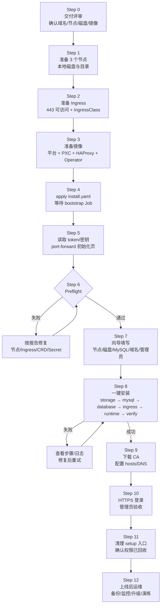

# FTC 平台生产交付手册

> **交付方式：`kubectl apply` + 浏览器初始化向导，不依赖 Helm。**
>
> 适用场景：3 个可调度节点、本地磁盘、PXC 3 节点 MySQL、自签 HTTPS Ingress。
> 本文按“一步一停”的方式编写：每一步都有 **目标 / 操作 / 通过标准 / 失败处理**。未通过当前步骤，不要进入下一步。

---

## 0. 交付总览图



**一句话流程：**

```text
准备资源 → 装好 Ingress → 镜像入库 → apply 引导清单 → 取 token
→ 打开向导 → 预检 → 填参安装 → 装 CA/配 hosts → 登录验收 → 清理 setup
```

---

## 1. 交付物清单

| 交付物 | 位置/说明 | 谁提供 |
| --- | --- | --- |
| 安装清单 | [`deploy/install.yaml`](../../deploy/install.yaml) | 平台方 |
| 初始化向导 | setup 镜像内置，浏览器访问 | 平台方 |
| 平台镜像 | 例如 `registry.example.com/ftc/ftc-platform:0.1.0` | 平台方构建 |
| PXC Operator | `percona/percona-xtradb-cluster-operator:1.18.0` | 平台方/镜像仓库 |
| PXC / HAProxy / XtraBackup | 见第 2.5 节镜像表 | 平台方/镜像仓库 |
| Ingress Controller | ingress-nginx，**不使用 Helm 安装** | 客户/平台方 |
| 内部域名 | 例如 `ftc-platform.cmb.local` | 客户 |
| 3 块本地盘 | 每节点一块，建议 ≥200GiB | 客户 |
| 管理员账号 | 初始化时设置 | 客户 |

---

## 2. 资源清单（开工前逐项打勾）

### 2.1 集群资源

| 资源 | 最低要求 | 推荐 | 检查命令 |
| --- | --- | --- | --- |
| Kubernetes | 1.27+；本项目在 1.31 验证 | 1.31/1.32 | `kubectl version` |
| 可调度节点 | **3 个 worker**（control-plane 不计入） | 3 worker + 3 control-plane | `kubectl get nodes` |
| 单节点 CPU | 4 vCPU | 8 vCPU | `kubectl describe node <node>` |
| 单节点内存 | 8 GiB | 16 GiB | 同上 |
| MySQL 本地盘 | 每节点 ≥100GiB，独立于系统盘 | 每节点 ≥200GiB SSD/NVMe | `lsblk` / `df -h` |
| 系统盘 | 100GiB | 200GiB | `df -h /` |
| 架构 | amd64 或 arm64，镜像需匹配 | 多架构 manifest | `uname -m` |
| 权限 | 可创建 Namespace/PV/SC/CRD/Ingress/RBAC | 集群管理员 | `kubectl auth can-i '*' '*'` |
| 时间同步 | 所有节点 NTP/chrony 正常 | 同一时区/时间源 | `timedatectl` |

**3 个 worker 合计：**

| 口径 | CPU | 内存 | MySQL 数据盘 |
| --- | --- | --- | --- |
| 最低 | 12 vCPU | 24 GiB | 300 GiB（3×100） |
| 推荐 | 24 vCPU | 48 GiB | 600 GiB（3×200） |

> 这是 3 个 worker 的合计，不含 control-plane 和系统盘。PXC 的 requests 约 3 CPU/6GiB，HAProxy 约 0.3 CPU/384MiB，其余留给平台 Pod、Ingress 和突发负载。

> **不要用 3 个“总节点”包含 control-plane 来凑数。** PXC 有反亲和，3 个 PXC 副本需要 3 个可调度节点；control-plane 默认带 NoSchedule 污点。

### 2.2 网络与端口

| 端口 | 方向 | 用途 | 是否必须 |
| --- | --- | --- | --- |
| 443/TCP | 用户 → 任意 worker/VIP | HTTPS 登录 | 必须 |
| 80/TCP | 用户 → 任意 worker/VIP | HTTP 跳转/ACME 备用 | 可选 |
| 6443/TCP | 管理员/堡垒机 → control-plane | kubectl | 必须（按现有集群） |
| 3306/TCP | 平台 Pod → HAProxy Service | MySQL 读写 | 集群内，不对外 |
| 33062/TCP | HAProxy → PXC | 管理/健康检查 | 集群内，不对外 |
| 8404/TCP | 运维 → HAProxy | HAProxy 监控 | 仅内网 |
| 9090/TCP | 监控 → 平台 API | Prometheus 指标 | 仅内网 |

如果使用外部负载均衡/VIP，**443 要转发到 ingress-nginx**，而不是直接转发到平台 Pod。

### 2.3 Ingress 资源

| 项 | 要求 |
| --- | --- |
| Controller | ingress-nginx（或其他支持 `networking.k8s.io/v1` Ingress 的控制器） |
| IngressClass | 例如 `nginx`；向导中要填同一个名字 |
| TLS 终止 | 必须在 Ingress/Controller 层终止 TLS，不能是四层 TCP 透传 |
| 443 暴露 | hostNetwork、hostPort、LoadBalancer 或外部 VIP 均可 |
| 证书 | 平台默认生成自签 CA；也可后续替换为 cert-manager/企业 CA |
| 域名 | 必须是合法 DNS 名称，建议内部二级域名，例如 `ftc-platform.cmb.local` |

**本平台只创建 Ingress，不负责安装 Ingress Controller。** 生产环境应复用客户已有的 ingress-nginx。

### 2.4 存储资源

3 个节点各准备一块**独立本地盘**，不要使用 NFS/Ceph 等共享存储替代 MySQL 数据盘。

| 节点 | 挂载点 | 用途 | 权限 |
| --- | --- | --- | --- |
| worker-1 | `/data/ftc-platform/mysql` | PXC 副本 1 数据 | `1001:1001`，`0770` |
| worker-2 | `/data/ftc-platform/mysql` | PXC 副本 2 数据 | 同上 |
| worker-3 | `/data/ftc-platform/mysql` | PXC 副本 3 数据 | 同上 |

说明：

- 三个节点可以使用**相同路径**，因为 PV 是节点绑定的；
- 不要在同一节点给两个 PXC 副本复用同一路径；
- 本地 PV 使用 `Retain`，**不支持在线扩容**；容量不足只能换盘/迁移；
- 节点故障时，该节点上的 PXC 副本不会自动漂移，需要人工替换节点并重建 PV。

### 2.5 镜像资源

| 镜像 | 用途 | 示例 |
| --- | --- | --- |
| 平台镜像 | API/Collector/Worker/Setup/Bootstrap | `registry.example.com/ftc/ftc-platform:0.1.0` |
| PXC Operator | 管理 PXC 集群 | `percona/percona-xtradb-cluster-operator:1.18.0` |
| PXC | MySQL 3 副本 | `percona/percona-xtradb-cluster:8.0.42-33.1` |
| HAProxy | MySQL 读写入口 | `percona/haproxy:2.8.15` |
| XtraBackup | 备份（如启用） | `percona/percona-xtrabackup:8.0.42-33.1` |
| ingress-nginx | 入口控制器 | `registry.k8s.io/ingress-nginx/controller:v1.11.3` |
| kube-bench | 安全扫描（可选） | `aquasec/kube-bench:v0.16.0` |

> 镜像放 registry，不要提交到 Git。离线交付用 `skopeo copy --all`/`docker save` 导入客户 registry 或节点。

### 2.6 账号与密钥

| 项 | 说明 |
| --- | --- |
| setup token | 引导 Job 生成，一次性使用 |
| encryption key | 引导 Job 生成，**必须离线备份**；丢失后已纳管集群的 Kubeconfig 无法解密 |
| 管理员密码 | 初始化向导设置，至少 12 位，建议 16 位以上 |
| registry 凭据 | 私有仓库的只读拉取账号 |
| CA 私钥 | 由平台生成并保存在 `ftc-platform-ca` Secret；不要导出到不受控位置 |

---

## 3. Step 0：交付评审（不执行命令）

在动手前，和客户确认并填入下表。**这张表就是后续所有步骤的输入。**

| 决策项 | 客户填写 | 示例 |
| --- | --- | --- |
| 内部域名 |  | `ftc-platform.cmb.local` |
| IngressClass |  | `nginx` |
| 3 个 worker 节点名 |  | `prod-worker-01/02/03` |
| 3 个 MySQL 路径 |  | `/data/ftc-platform/mysql` |
| 单卷容量 |  | `200Gi` |
| 平台镜像 |  | `registry.example.com/ftc/ftc-platform:0.1.0` |
| 私有仓库地址 |  | `registry.example.com` |
| imagePullSecret 名称 |  | `ftc-platform-registry` |
| PXC/HAProxy/Operator 镜像 |  | 见第 2.5 节 |
| 管理员用户名 |  | `admin` |
| 备份目标 |  | S3/NFS（上线前必须确定） |
| 变更窗口 |  | 例如周六 00:00–02:00 |

评审结论：

- [ ] 3 个 worker 可调度，且不在同一台物理机；
- [ ] 每节点有独立本地盘；
- [ ] 443 可从用户网段访问；
- [ ] 内部域名可解析，或确认用 hosts；
- [ ] 镜像可从客户集群拉取；
- [ ] 已确定备份方案和回滚窗口。

---

## 4. Step 1：准备节点和本地磁盘

### 目标

3 个 worker 可调度，每个节点有独立数据盘，路径对 PXC 运行用户可写。

### 操作

1. 确认节点：

```bash
kubectl get nodes -o wide
kubectl get nodes -o custom-columns='NAME:.metadata.name,READY:.status.conditions[?(@.type=="Ready")].status,SCHEDULABLE:.spec.unschedulable'
```

2. 确认节点资源：

```bash
kubectl describe node <worker-1> | sed -n '/Allocatable/,+8p'
kubectl describe node <worker-2> | sed -n '/Allocatable/,+8p'
kubectl describe node <worker-3> | sed -n '/Allocatable/,+8p'
```

3. 在每个 worker 上准备独立盘（示例，盘符按实际替换）：

```bash
# 在每台 worker 上执行
# 警告：先确认盘符，绝不要对系统盘执行 mkfs
lsblk
sudo mkfs.xfs /dev/<data-disk>
sudo mkdir -p /data
sudo mount /dev/<data-disk> /data
echo '/dev/<data-disk> /data xfs defaults,noatime 0 2' | sudo tee -a /etc/fstab

sudo mkdir -p /data/ftc-platform/mysql
sudo chown -R 1001:1001 /data/ftc-platform/mysql
sudo chmod 0770 /data/ftc-platform/mysql
```

4. 确认路径和权限：

```bash
df -h /data
ls -ld /data/ftc-platform/mysql
# 预期：drwxrwx--- 1001 1001
```

### 通过标准

- 3 个 worker 均为 `Ready` 且 `SCHEDULABLE` 为空；
- 每节点 `/data` 已挂载，容量 ≥100GiB；
- `/data/ftc-platform/mysql` 属主 `1001:1001`，权限 `0770`；
- 三个节点使用相同路径没有问题。

### 失败处理

| 现象 | 处理 |
| --- | --- |
| 只有 2 个可调度 worker | 增加节点，或去掉 control-plane 的 NoSchedule 污点（不推荐生产） |
| 磁盘未挂载 | 先修复 `/etc/fstab`，重启后确认 `df -h` |
| 权限不对 | `chown 1001:1001`；PXC 容器以 UID 1001 运行 |
| 路径是 NFS | 不要用于 PXC 数据盘；改用本地盘 |

---

## 5. Step 2：准备 Ingress（不使用 Helm）

### 目标

`IngressClass` 存在，443 能从用户网段访问，TLS 在 Ingress 层终止。

### 操作

1. 检查是否已有 ingress-nginx：

```bash
kubectl get ingressclass
kubectl -n ingress-nginx get pods,svc
```

2. 如果已有，记录 IngressClass 名称（通常 `nginx`），跳到“通过标准”。

3. 如果没有，使用静态清单安装 ingress-nginx（**不是 Helm**）：

```bash
kubectl apply -f https://raw.githubusercontent.com/kubernetes/ingress-nginx/controller-v1.11.3/deploy/static/provider/baremetal/deploy.yaml
kubectl -n ingress-nginx rollout status deployment/ingress-nginx-controller --timeout=10m
kubectl get ingressclass
```

> 官方 baremetal 清单默认是 NodePort。生产上需要满足以下任一种：
> - 外部 LB/VIP 把 443 转发到 ingress-nginx；
> - 把 controller 改成 hostNetwork/hostPort 80/443；
> - 使用云厂商 LoadBalancer。
>
> 平台只创建 Ingress，不负责把 443 暴露到集群外。

4. 验证 443 的 TLS 握手（即使返回 404 也说明 TLS 正常）：

```bash
curl -kI https://<任一节点IP或VIP>/
# 预期：HTTP/2 404 或 200；不应是 connection refused/timeout
```

5. 如果使用 hosts 而不是内部 DNS，先准备客户端记录（Step 9 再正式配置）：

```text
<VIP或任一节点IP>  ftc-platform.cmb.local
```

### 通过标准

- `kubectl get ingressclass` 至少有一个，名字与向导中填写一致；
- `curl -kI https://<IP>/` 能完成 TLS 握手；
- 防火墙允许用户网段访问 443；
- 确认 Ingress 是 TLS 终止，不是四层透传。

### 失败处理

| 现象 | 处理 |
| --- | --- |
| `connection refused` | controller 未监听 443，检查 Service/hostPort/LB |
| `404` 但 TLS 成功 | 正常，说明还没有 Ingress 规则 |
| `no such host` | DNS/hosts 未配置 |
| `ingressclass` 为空 | controller 未安装或未就绪 |
| 客户使用其他 Controller | 确认支持 `networking.k8s.io/v1` Ingress 和 TLS Secret |

---

## 6. Step 3：准备镜像

### 目标

客户集群能从 registry 拉取平台和 PXC 相关镜像；私有仓库已配置 imagePullSecret。

### 操作

1. 构建并推送平台镜像（在构建机执行，不在 K8s 节点执行）：

```bash
# 单架构（匹配目标节点架构）
docker build -t registry.example.com/ftc/ftc-platform:0.1.0 .
docker push registry.example.com/ftc/ftc-platform:0.1.0

# 多架构（推荐）
docker buildx build \
  --platform linux/amd64,linux/arm64 \
  -t registry.example.com/ftc/ftc-platform:0.1.0 \
  --push .
```

2. 把第三方镜像同步到客户 registry（或确认客户可直接拉取）：

```bash
# 有 skopeo 时，多架构镜像用 --all 保留 manifest list
skopeo copy --all docker://percona/percona-xtradb-cluster-operator:1.18.0 \
  docker://registry.example.com/ftc/percona-xtradb-cluster-operator:1.18.0
skopeo copy --all docker://percona/percona-xtradb-cluster:8.0.42-33.1 \
  docker://registry.example.com/ftc/percona-xtradb-cluster:8.0.42-33.1
skopeo copy --all docker://percona/haproxy:2.8.15 \
  docker://registry.example.com/ftc/percona-haproxy:2.8.15
skopeo copy --all docker://percona/percona-xtrabackup:8.0.42-33.1 \
  docker://registry.example.com/ftc/percona-xtrabackup:8.0.42-33.1
```

> 如果客户集群节点不能出网，优先推客户 registry；也可以 `docker save`/`ctr import` 到节点，但不建议作为长期方案。

3. 创建 imagePullSecret（命名空间由 `install.yaml` 创建）：

```bash
kubectl create namespace ftc-platform --dry-run=client -o yaml | kubectl apply -f -

kubectl -n ftc-platform create secret docker-registry ftc-platform-registry \
  --docker-server=registry.example.com \
  --docker-username='<user>' \
  --docker-password='<password>'
```

4. 如果 setup/bootstrap 使用私有平台镜像，推荐在 Step 4 复制出 `/tmp/ftc-install.yaml` 后、apply 之前，给两个 ServiceAccount 增加：

```yaml
imagePullSecrets:
  - name: ftc-platform-registry
```

如果已经 apply 并出现 `ImagePullBackOff`，按 Step 4 的“私有镜像补充”处理；若使用公开镜像或节点已预加载，可跳过 Secret。

### 通过标准

- 平台镜像在客户 registry 可拉取；
- PXC/HAProxy/Operator 镜像已同步（或可直接拉取）；
- `ftc-platform-registry` Secret 存在；
- 节点的容器运行时能解析 registry 地址。

### 失败处理

| 现象 | 处理 |
| --- | --- |
| `ImagePullBackOff` | `kubectl describe pod` 看仓库地址/认证 |
| `401/403` | 检查 imagePullSecret 和 ServiceAccount |
| `no match for platform` | 镜像架构与节点不一致，补多架构 manifest |
| 拉取超时 | 使用客户内网 registry 或预加载节点 |

---

## 7. Step 4：apply 安装清单

### 目标

创建 Namespace、RBAC、Bootstrap Job、Setup 入口、PXC Operator；生成一次性 token 和加密密钥。

### 操作

1. 复制并替换平台镜像占位符（三处）：

```bash
cp deploy/install.yaml /tmp/ftc-install.yaml
sed -i 's|REPLACE_WITH_PLATFORM_IMAGE|registry.example.com/ftc/ftc-platform:0.1.0|g' /tmp/ftc-install.yaml

# 必须为空
grep -n 'REPLACE_WITH_PLATFORM_IMAGE' /tmp/ftc-install.yaml || echo "image placeholder ok"
```

2. 服务端 dry-run（先确保命名空间存在）：

```bash
kubectl create namespace ftc-platform --dry-run=client -o yaml | kubectl apply -f -
kubectl apply -n ftc-platform -f /tmp/ftc-install.yaml --dry-run=server
```

3. 正式 apply：

```bash
kubectl apply -n ftc-platform -f /tmp/ftc-install.yaml
```

4. 先检查 bootstrap/setup 是否在拉镜像：

```bash
kubectl -n ftc-platform get pods
kubectl -n ftc-platform get job ftc-platform-bootstrap
```

如果出现 `ImagePullBackOff` / `ErrImagePull`，且两个 ServiceAccount 还没有拉取 Secret：

```bash
kubectl -n ftc-platform patch serviceaccount ftc-platform-bootstrap \
  -p '{"imagePullSecrets":[{"name":"ftc-platform-registry"}]}'
kubectl -n ftc-platform patch serviceaccount ftc-platform-setup \
  -p '{"imagePullSecrets":[{"name":"ftc-platform-registry"}]}'

kubectl -n ftc-platform delete job ftc-platform-bootstrap --ignore-not-found
kubectl -n ftc-platform delete pod -l app.kubernetes.io/name=ftc-platform-setup --ignore-not-found
kubectl apply -n ftc-platform -f /tmp/ftc-install.yaml
```

5. 等待引导 Job：

```bash
kubectl -n ftc-platform wait --for=condition=complete job/ftc-platform-bootstrap --timeout=15m
kubectl -n ftc-platform logs job/ftc-platform-bootstrap
```

6. 读取 token 和加密密钥（以 Secret 为准）：

```bash
kubectl -n ftc-platform get secret ftc-platform-bootstrap \
  -o jsonpath='{.data.setup-token}' | base64 -d; echo
kubectl -n ftc-platform get secret ftc-platform-bootstrap \
  -o jsonpath='{.data.encryption-key}' | base64 -d; echo
```

**立即做两件事：**

- 把 `encryption-key` 存进客户密钥管理系统/离线保险柜；
- 把 `setup-token` 只交给执行初始化的人，不要发群、不要写入 Git。

### 通过标准

- `kubectl -n ftc-platform get pods` 中 bootstrap Job `Completed`；
- `secret/ftc-platform-bootstrap` 存在，含 `setup-token`、`encryption-key`；
- `deployment/ftc-platform-setup` Ready；
- PXC Operator Deployment 启动（可能稍后 Ready）。

### 失败处理

| 现象 | 处理 |
| --- | --- |
| Job `ImagePullBackOff` | 回到 Step 3 配置 imagePullSecret |
| Job `Forbidden` | 检查 `ftc-platform-bootstrap` Role/SA |
| `secret not found` | 查看 Job 日志；不要手工伪造 token |
| setup Pod 未启动 | `kubectl describe pod -l app.kubernetes.io/name=ftc-platform-setup` |

---

## 8. Step 5：打开初始化页面

### 目标

在本地浏览器打开 setup 页面，不把 setup 入口暴露到公网。

### 操作

```bash
kubectl -n ftc-platform port-forward svc/ftc-platform-setup 8080:80 --address 127.0.0.1
```

浏览器打开：

```text
http://127.0.0.1:8080
```

如果操作机不能直连集群，用 SSH 隧道：

```bash
ssh -L 8080:127.0.0.1:8080 <user>@<bastion-or-node>
# 然后本地浏览器仍打开 http://127.0.0.1:8080
```

> 不要把 setup Service 通过 Ingress/NodePort 暴露到公网。setup 身份拥有命名空间内编排权限，只在初始化窗口内使用。

### 通过标准

- 页面能打开，显示“环境检查/初始化”；
- 输入 Step 4 的 setup token 能通过。

### 失败处理

| 现象 | 处理 |
| --- | --- |
| 端口被占用 | 换本地端口，例如 `18080:80` |
| `connection refused` | setup Pod 未 Ready，或 port-forward 退出 |
| 页面 404 | setup 镜像版本不对，确认镜像包含 setup 入口 |
| token 错误 | 重新从 Secret 读取，注意不要带换行 |

---

## 9. Step 6：Preflight

### 目标

在创建任何 PXC/PV 之前，确认集群具备安装条件。

### 操作

1. 在向导中输入 token，点击“环境检查”。
2. 逐项看报告；不要只看“通过/失败”总览。
3. 失败项按提示修复后重新检查。

Preflight 会检查：

| 检查项 | 期望 | 失败处理 |
| --- | --- | --- |
| 可调度节点 | ≥3 | 增加 worker / 去污点 |
| 架构 | 与镜像一致 | 准备对应架构镜像 |
| IngressClass | 存在 | 安装 ingress-nginx 或填正确名字 |
| PXC CRD | 存在 | 确认 apply 的是完整 `install.yaml` |
| 现有运行 Secret | 不存在 | 已初始化过；换命名空间或清理后重装 |
| StorageClass | 由安装创建/可用 | 一般无需手工创建 |
| Namespace/RBAC | 可读写 | 检查 kubeconfig 权限 |

### 通过标准

- 页面显示“环境检查通过”；
- 没有红色错误项；
- 你已确认 3 个节点名和 3 个路径就是 Step 1 准备的。

### 失败处理

| 现象 | 处理 |
| --- | --- |
| 节点少于 3 | 不要继续；PXC 3 副本无法满足反亲和 |
| `already initialized` | 说明已有运行 Secret；不要重复初始化，先确认是否已有平台 |
| IngressClass 不存在 | 回到 Step 2 |
| PXC CRD 不存在 | 重新 apply `/tmp/ftc-install.yaml`，确认 CRD 未被裁剪 |

---

## 10. Step 7：填写向导参数

### 目标

一次性填入节点、存储、MySQL、域名、管理员，生成安装计划。

### 操作

#### 10.1 数据库与存储

- 选择 3 个 **不同** 的 worker；
- 每个节点填同一个本地路径（例如 `/data/ftc-platform/mysql`）；
- 单卷容量建议 `200Gi`，最低 `100Gi`；
- 不要在同一节点重复选择同一路径。

#### 10.2 MySQL 镜像

| 字段 | 示例 |
| --- | --- |
| PXC Operator | `registry.example.com/ftc/percona-xtradb-cluster-operator:1.18.0` |
| PXC | `registry.example.com/ftc/percona-xtradb-cluster:8.0.42-33.1` |
| HAProxy | `registry.example.com/ftc/percona-haproxy:2.8.15` |
| XtraBackup | `registry.example.com/ftc/percona-xtrabackup:8.0.42-33.1` |
| imagePullSecret | `ftc-platform-registry` |

#### 10.3 访问配置

- 内部域名：`ftc-platform.cmb.local`（不要带 `https://`）；
- IngressClass：Step 2 确认的名字；
- 管理员用户名/密码：至少 12 位，建议 16 位以上，包含大小写、数字、符号；
- 平台运行镜像：如果与安装 ConfigMap 不同，在这里覆盖。

#### 10.4 确认

- 再次核对 3 个节点、3 个路径、容量、域名；
- 点击“开始安装”后不要关闭浏览器；
- 同一时间只允许一个安装任务。

### 通过标准

- 页面进入“安装中”；
- 每一步状态从 `pending → running → done`；
- 没有参数校验错误。

### 失败处理

| 现象 | 处理 |
| --- | --- |
| 路径重复 | 同一节点不能选两次；不同节点可以同路径 |
| 容量校验失败 | 不要低于 100Gi；本地盘容量要覆盖 PVC |
| 域名格式错误 | 使用小写 DNS 名称，不要带协议/路径 |
| 密码太短 | 按提示加长 |

---

## 11. Step 8：执行安装

### 目标

按顺序创建 local PV/SC、PXC 3 节点、应用库/管理员、自签 CA/Ingress、运行 Deployment，并做健康检查。

### 安装阶段

| 阶段 | 做什么 | 预计耗时 | 失败时先看 |
| --- | --- | --- | --- |
| `storage` | 创建 `ftc-platform-local` SC、3 个 local PV | <1 min | PV 节点名/路径/容量 |
| `mysql` | 创建 PXC CR、3 个 PXC + 3 个 HAProxy | 5–15 min | PXC/HAProxy Pod、PVC、镜像 |
| `database` | 创建 `ftc_platform` 库、应用账号、管理员、runtime Secret | 1–3 min | HAProxy 连接、PXC 状态、迁移日志 |
| `ingress` | 生成自签 CA、TLS Secret、Ingress | <1 min | IngressClass、域名、Secret |
| `runtime` | 创建 API/Collector/Worker、PDB、Service | 1–2 min | PDB RBAC、镜像、资源 |
| `verify` | 等待 API 健康检查 | 1–5 min | API Pod 日志、数据库连接 |

### 操作

1. 点击“开始安装”。
2. 观察每一步状态和消息。
3. 安装过程中不要：
   - 手工删除 PXC Pod/PVC；
   - 修改 PXC CR 的 size；
   - 重启 setup Pod（内存中的状态会丢失）。
4. 失败时先点“查看详情/日志”，不要直接重装。

### 常见失败与处理

| 错误 | 原因 | 处理 |
| --- | --- | --- |
| `ImagePullBackOff` | 镜像/Secret | 补 imagePullSecret，重建对应 Pod |
| `pxc_strict_mode=ENFORCING` / `GET_LOCK` | 平台迁移锁与 PXC 严格模式冲突 | 当前交付版 CR 已设置 `pxc_strict_mode=DISABLED`；旧镜像需升级 |
| `PXC 3 节点...` 长时间不完成 | 镜像慢/磁盘/资源不足/反亲和 | 看 PXC Pod 事件、PVC Bound、节点资源 |
| `PDB forbidden` | setup Role 缺 `poddisruptionbudgets` | 使用当前 `install.yaml`；旧清单需补 RBAC |
| `HAProxy` 无端点 | HAProxy 未 Ready/PXC 未就绪 | 看 HAProxy/pxc-monit 日志；不要只看 Pod Running |
| `verify` 超时 | API 未 Ready/DB 连接失败 | `kubectl logs deploy/ftc-platform` |
| 安装状态丢失 | setup Pod 重启 | 资源可能已部分创建；先检查再决定是否重试 |

### 通过标准

- 页面显示“安装完成”；
- `verify` 为 done；
- 结果页出现 URL、hosts、CA 下载；
- 没有任何步骤处于 running/failed。

### 失败处理

```bash
kubectl -n ftc-platform get pods,pvc,events --sort-by=.lastTimestamp
kubectl -n ftc-platform describe pxc platform-mysql
kubectl -n ftc-platform logs deployment/ftc-platform-setup --tail=200
kubectl -n ftc-platform logs deployment/ftc-platform --tail=200
```

如果失败发生在 `runtime` 之后且 runtime Secret 已创建，当前代码允许在 `failed` 状态下重试；不要删除 Secret 来“强行重装”。

---

## 12. Step 9：CA、hosts 与首次登录

### 目标

客户端信任平台 CA，域名解析到入口，浏览器能打开登录页。

### 操作

1. 从结果页下载 CA（也可从 Secret 取）：

```bash
kubectl -n ftc-platform get secret ftc-platform-ca \
  -o jsonpath='{.data.ca\.crt}' | base64 -d > ftc-platform-ca.crt
```

2. 把 CA 导入客户端信任库：

macOS：

```bash
sudo security add-trusted-cert -d -r trustRoot \
  -k /Library/Keychains/System.keychain ftc-platform-ca.crt
```

Linux（Debian/Ubuntu）：

```bash
sudo cp ftc-platform-ca.crt /usr/local/share/ca-certificates/ftc-platform-ca.crt
sudo update-ca-certificates
```

Windows：

```text
certmgr.msc → 受信任的根证书颁发机构 → 导入 → 选择 ftc-platform-ca.crt
```

3. 配置 hosts（没有内部 DNS 时）：

macOS/Linux：

```bash
sudo sh -c 'echo "10.20.30.11  ftc-platform.cmb.local" >> /etc/hosts'
```

Windows：

```text
C:\Windows\System32\drivers\etc\hosts
10.20.30.11  ftc-platform.cmb.local
```

> 优先使用内部 DNS 或 VIP；不要把 hosts 指向会漂移的单个节点 IP。生产建议用 4 层 VIP/LB。

4. 浏览器访问：

```text
https://ftc-platform.cmb.local
```

5. 命令行验证：

```bash
curl -I --cacert ftc-platform-ca.crt https://ftc-platform.cmb.local/
curl -s --cacert ftc-platform-ca.crt https://ftc-platform.cmb.local/api/v1/health
```

### 通过标准

- 浏览器无证书警告；
- 登录页返回 200；
- `/api/v1/health` 返回 `{"status":"ok"}`；
- 管理员能登录。

### 失败处理

| 现象 | 处理 |
| --- | --- |
| 证书不受信任 | 确认导入的是 `ftc-platform-ca`，不是 `ftc-platform-tls` |
| `NET::ERR_CERT_COMMON_NAME_INVALID` | 域名与证书 SAN 不一致；重新安装时填正确域名 |
| 404 | Ingress host/class 不匹配 |
| 502 | Service 无端点，检查 API Pod |
| 连接拒绝 | 443 未暴露或 hosts 指错 |

---

## 13. Step 10：生产验收

### 目标

确认不是“页面能开”而已，而是数据库、入口、运行面、权限回收都正确。

逐项执行：

```bash
kubectl -n ftc-platform get pvc,pv,statefulset,pod,ingress,secret
kubectl -n ftc-platform get perconaxtradbcluster platform-mysql
kubectl -n ftc-platform get endpoints platform-mysql-haproxy
kubectl -n ftc-platform rollout status deployment/ftc-platform --timeout=5m
kubectl -n ftc-platform get rolebinding,clusterrolebinding | grep ftc-platform-setup
```

| 验收项 | 期望 | 不通过时 |
| --- | --- | --- |
| PXC | 3/3 Running，CR `ready` | 看 PXC Pod/日志 |
| HAProxy | 3/3 或至少 2/3 Ready | 看 pxc-monit/健康检查 |
| PVC | 3 个 Bound | 看 PV 节点/容量 |
| Ingress | 有 TLS、host 正确 | 看 IngressClass/Secret |
| API | Deployment Ready | 看 Pod/DB 日志 |
| Collector/Worker | Ready | 看镜像/权限 |
| setup 权限 | RoleBinding/ClusterRoleBinding 已删除 | 等 30 秒；仍存在则查回收逻辑 |
| 登录 | admin 可登录 | 看 auth/DB |
| CA | 浏览器信任 | 重新导入 |

另外检查：

```bash
kubectl -n ftc-platform get secret ftc-platform-tls ftc-platform-ca
kubectl -n ftc-platform get ingress ftc-platform -o yaml
```

### 通过标准

- 所有验收项通过；
- `permissions_revoked` 为 true（结果页/状态接口）；
- 管理员登录后能看到平台首页；
- 已记录 PXC/HAProxy/API 的当前镜像 digest。

---

## 14. Step 11：清理 setup 入口

### 目标

初始化完成后，移除 setup 的浏览器入口，减少攻击面。

### 操作

1. 确认 setup 权限已经回收：

```bash
kubectl -n ftc-platform get rolebinding ftc-platform-setup
kubectl -n ftc-platform get clusterrolebinding ftc-platform-setup
# 预期：NotFound
```

2. 删除 setup Deployment/Service（保留 Namespace 和 CA/TLS Secret）：

```bash
kubectl -n ftc-platform delete deployment ftc-platform-setup
kubectl -n ftc-platform delete service ftc-platform-setup
```

3. 保留以下对象，不要删：

- `secret/ftc-platform-bootstrap`（token 已失效，但 encryption key 仍需保留）；
- `secret/ftc-platform-ca`；
- `secret/ftc-platform-tls`；
- `secret/ftc-platform-runtime`。

> 如果还需要重新初始化，必须重新 apply `install.yaml` 并重新生成 bootstrap Secret；不要复用旧 token。

### 通过标准

- setup Service/Deployment 删除；
- 正式平台仍可登录；
- CA/TLS Secret 保留。

---

## 15. Step 12：上线后运维

### 15.1 备份（上线前必须完成）

当前交付包**没有内置备份 CronJob**。上线前必须补：

- 使用 XtraBackup 对 PXC 做全量/增量备份；
- 备份到 S3/NFS/对象存储；
- 至少每周全量、每日增量；
- 每季度做一次恢复演练；
- 备份文件加密，密钥与备份分开存放。

最低要求：在变更窗口前手工做一次全量备份，并验证可恢复。

### 15.2 监控

- 平台 API `/metrics`（9090）只在内网暴露；
- 监控 PXC 3 副本、HAProxy 端点、PVC 使用率、API 5xx、登录失败；
- 对 `PVC > 80%`、`PXC ready < 3`、`HAProxy endpoints < 2` 告警。

### 15.3 升级（无 Helm）

当前没有 Helm release，升级通过替换运行镜像完成：

1. 先做数据库全量备份；
2. 构建并推送新平台镜像；
3. 更新 API/Collector/Worker 镜像：
   ```bash
   kubectl -n ftc-platform set image deployment/ftc-platform platform=<new-image>
   kubectl -n ftc-platform set image deployment/ftc-platform-collector platform=<new-image>
   kubectl -n ftc-platform set image deployment/ftc-platform-worker platform=<new-image>
   kubectl -n ftc-platform rollout status deployment/ftc-platform
   ```
4. API 启动时执行数据库迁移；迁移失败立即停止并回滚镜像；
5. 数据库迁移通常不可逆，回滚镜像不等于回滚数据；必要时从备份恢复。

> 升级前必须在测试环境验证 N-1 → N；当前交付包没有自动回滚。

### 15.4 节点故障

- 本地 PV 绑定节点，故障节点的 PXC 副本不会漂移；
- 剩余 2 个 PXC 副本可维持仲裁，但不要长期运行在 2 副本；
- 替换节点后，需要重建该节点的本地 PV，并让 PXC 重新加入；
- 具体步骤必须结合客户磁盘/节点替换流程演练。

### 15.5 卸载

```bash
# 先确认已备份
kubectl delete namespace ftc-platform
kubectl delete pv -l ftc-platform/role=mysql-data
kubectl delete sc ftc-platform-local
kubectl delete clusterrole ftc-platform-setup --ignore-not-found
kubectl delete clusterrolebinding ftc-platform-setup --ignore-not-found
```

> 不要直接 `kubectl delete -f install.yaml`：清单里包含 PXC CRD，删除 CRD 会级联删除集群内**所有** PXC 集群。只有确认这台集群没有其他 PXC 实例时，才考虑删除 CRD。
>
> 删除 PV/本地目录会丢失数据；先做备份并确认。

### 15.6 安全基线

- 初始化后立即删除 setup Deployment/Service；
- 不在 Git/聊天工具中保存 setup token/encryption key；
- 限制 9090/8404 只在内网；
- 为平台 API 配置 NetworkPolicy（如集群支持）；
- 定期轮换管理员密码；
- 自签 CA 有效期 5 年，到期前重新签发并替换 TLS Secret；
- 镜像使用 digest/不可变 tag，记录 SBOM/来源。

---

## 16. 已知限制（必须在交付说明中写明）

- 本地 PV 节点绑定，节点故障不能自动漂移；PXC 3 副本可容忍 1 个节点故障，但故障副本需要人工重建。
- 本地 PV 不支持在线扩容；容量规划要一次性留足。
- 自签 CA 只适合内部环境；企业 CA/cert-manager 需后续替换 TLS Secret。
- 当前只支持集群内 PXC；已有托管 MySQL 的环境需要改 DSN/Secret，尚未做成向导选项。
- 安装状态保存在 setup Pod 内存中；Pod 重启后状态页丢失，已创建资源不受影响。
- 备份/恢复、自动升级/回滚尚未内置；上线前必须补流程。
- Ingress 依赖客户提供 ingress-nginx 和 443 暴露方式；平台不安装 Controller。
- setup token 一次性；encryption key 丢失后已纳管集群的 Kubeconfig 无法解密。

---

## 附录 A：一页纸检查清单

```text
[ ] 3 个 worker 可调度
[ ] 每节点独立本地盘，/data/ftc-platform/mysql 属主 1001:1001
[ ] IngressClass 存在，443 可访问
[ ] 内部域名确定，DNS/hosts 方案确定
[ ] 平台/PXC/HAProxy/Operator 镜像可拉取
[ ] imagePullSecret 已创建
[ ] install.yaml 的 REPLACE_WITH_PLATFORM_IMAGE 已替换
[ ] bootstrap Job Completed
[ ] setup token/encryption key 已备份
[ ] Preflight 无错误
[ ] 向导三节点/三路径/容量/域名/管理员已核对
[ ] 安装完成，PXC 3/3、HAProxy ≥2/3
[ ] CA 已导入客户端
[ ] https 登录成功
[ ] setup RoleBinding/ClusterRoleBinding 已删除
[ ] 备份方案已确定并演练
```

## 附录 B：常用排查命令

```bash
# 总览
kubectl -n ftc-platform get pods,pvc,svc,ingress,secret
kubectl -n ftc-platform get events --sort-by=.lastTimestamp | tail -30

# bootstrap/setup
kubectl -n ftc-platform logs job/ftc-platform-bootstrap
kubectl -n ftc-platform logs deploy/ftc-platform-setup --tail=200

# PXC
kubectl -n ftc-platform get pxc platform-mysql
kubectl -n ftc-platform get pods -l app.kubernetes.io/instance=platform-mysql
kubectl -n ftc-platform describe pxc platform-mysql

# 平台
kubectl -n ftc-platform logs deploy/ftc-platform --tail=200
kubectl -n ftc-platform port-forward svc/ftc-platform 8080:8080

# Ingress/TLS
kubectl -n ftc-platform get ingress ftc-platform -o yaml
kubectl -n ftc-platform get secret ftc-platform-tls ftc-platform-ca
```

## 附录 C：无 Helm 的 Ingress 说明

本平台不依赖 Helm。Ingress Controller 由客户提供，验收标准只有三条：

1. `kubectl get ingressclass` 有可用的 Class；
2. 443 能完成 TLS 握手，并转发到 Ingress；
3. Ingress 能按 host 路由到 `ftc-platform` Service。

如果客户没有 ingress-nginx，可用 Step 2 的静态清单安装；如果客户已有其他 Ingress Controller，只要支持 `networking.k8s.io/v1` 和 TLS Secret，也可以复用，向导里填对应 IngressClass 即可。
