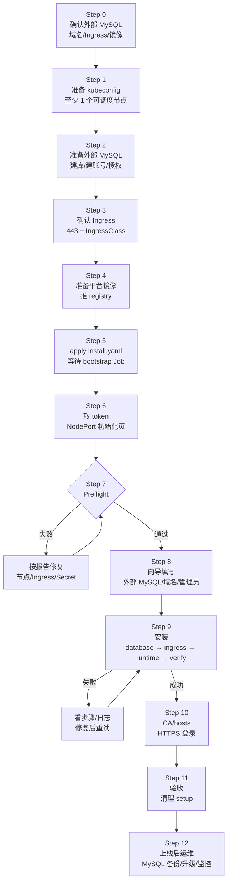
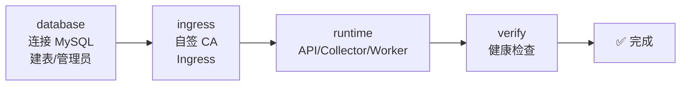

# FTC 平台生产交付手册（外部 MySQL · 无 Helm · 一人可完成）

> **交付方式：`kubectl apply` + 浏览器初始化向导，不依赖 Helm。**
>
> 本版本**不在集群内安装 MySQL**：使用你已有的外部 MySQL 8.0+。平台只创建表结构、管理员、Ingress 和运行 Deployment，因此不再需要 3 个 worker、本地盘、PXC Operator、HAProxy 或 PXC 镜像。
>
> `install.yaml` 同时包含 **ingress-nginx（hostNetwork，节点 80/443）**；不需要再手动装 Controller。
>
> 面向第一次部署的人：按 Step 0–12 顺序执行；每一步都有 **目标 / 操作 / 通过标准 / 失败处理**。第一次接触 Kubernetes 的读者可先看 [小白版](install-beginner.md)。

**为什么改成外部 MySQL：**

- 少 3 个 StatefulSet、3 个 PVC、PXC Operator 和 HAProxy；
- 不需要为 MySQL 规划本地盘和反亲和；
- 数据库的备份、HA、监控由现有 MySQL 体系负责；
- 平台本身变成无状态服务，节点故障后可直接重新调度。

---

## 0. 交付总览图



**一句话：**

```text
准备 kubeconfig 和外部 MySQL → 确认 Ingress → 推镜像 → apply
→ 取 token → 打开向导 → 预检 → 填 MySQL/域名/管理员 → 安装
→ 装 CA/配 hosts → 登录 → 验收 → 清理 setup
```

---

## 1. 交付物清单

| 交付物 | 位置/说明 |
| --- | --- |
| 安装清单 | [`deploy/install.yaml`](../../deploy/install.yaml)（不含 MySQL/PXC） |
| 初始化向导 | setup 镜像内置，浏览器访问 |
| 平台镜像 | 例如 `registry.example.com/ftc/ftc-platform:0.1.0` |
| 外部 MySQL | 8.0+，已有库/账号，或由你创建 |
| Ingress Controller | 已包含在 `install.yaml`（hostNetwork，节点 80/443） |
| 内部域名 | 例如 `ftc-platform.cmb.local` |
| 管理员账号 | 初始化时设置 |

**不再需要：**

- PXC Operator / PXC / HAProxy / XtraBackup 镜像；
- 3 个 worker 的本地盘；
- 本地 PV/StorageClass；
- 3 节点 MySQL 反亲和规划。

---

## 2. 资源清单

### 2.1 Kubernetes 集群

| 资源 | 最低 | 推荐 | 检查 |
| --- | --- | --- | --- |
| Kubernetes | 1.27+；本项目在 1.31 验证 | 1.31/1.32 | `kubectl version` |
| 可调度节点 | **1 个** | 2 个以上 | `kubectl get nodes` |
| 单节点 CPU | 2 vCPU | 4 vCPU | `kubectl describe node <node>` |
| 单节点内存 | 4 GiB | 8 GiB | 同上 |
| 权限 | 创建 Namespace/Secret/Deployment/Ingress/RBAC | 集群管理员 | `kubectl auth can-i '*' '*'` |
| 时间同步 | NTP/chrony 正常 | 同一时间源 | `timedatectl` |

> 单节点可以完成安装，但**不是高可用**：节点故障时平台 Pod 无法重新调度。生产建议 2 个以上可调度节点，API/Collector 可以各 2 副本。
>
> 不再要求 3 个 worker；也不再检查 PXC CRD 和 StorageClass。

### 2.2 外部 MySQL

| 资源 | 要求 |
| --- | --- |
| 版本 | MySQL 8.0+（PXC 8.0 也可作为外部 MySQL 使用） |
| 数据库 | 已创建，例如 `ftc_platform` |
| 账号 | 例如 `ftc`，对 `ftc_platform.*` 有建表/改表/索引权限 |
| 网络 | 集群节点/Pod 能访问 MySQL 的 3306（或自定义端口） |
| TLS | 可选；内网可关闭，跨网建议开启 |
| 备份/HA | 由现有 MySQL 体系负责；平台不创建也不备份数据库 |
| 规格 | 最低 2 vCPU/4GiB/50GiB；按纳管集群量评估 |

建库/建账号 SQL：

```sql
CREATE DATABASE ftc_platform
  CHARACTER SET utf8mb4
  COLLATE utf8mb4_0900_ai_ci;

CREATE USER 'ftc'@'%' IDENTIFIED BY '<强密码>';
GRANT ALL PRIVILEGES ON ftc_platform.* TO 'ftc'@'%';
FLUSH PRIVILEGES;
```

> 平台不会执行 `CREATE DATABASE` 或 `CREATE USER`；请先创建，或用管理员账号完成。账号至少需要目标库的 `CREATE/ALTER/INDEX/INSERT/UPDATE/DELETE/SELECT` 权限。

### 2.3 Ingress

| 项 | 要求 |
| --- | --- |
| Controller | ingress-nginx 或兼容 `networking.k8s.io/v1` 的 Controller |
| IngressClass | 例如 `nginx`，向导中填同一个 |
| 443 | 由 `install.yaml` 的 ingress-nginx hostNetwork 监听；TLS 在 Ingress 层终止 |
| 证书 | 平台默认生成自签 CA；后续可替换为企业 CA |

### 2.4 镜像

| 镜像 | 用途 | 是否必需 |
| --- | --- | --- |
| 平台镜像 | API/Collector/Worker/Setup/Bootstrap | 必需 |
| ingress-nginx | 入口控制器，`install.yaml` 内置 hostNetwork | 必需（已包含） |
| kube-webhook-certgen | ingress-nginx admission 证书 Job | 必需（已包含） |
| kube-bench | 安全扫描（可选） | 可选 |

> 不再需要 PXC/HAProxy/Operator/XtraBackup 镜像。镜像放 registry，不要提交到 Git；离线用 `skopeo copy --all` 或 `docker save`。

### 2.5 账号与密钥

| 项 | 说明 |
| --- | --- |
| kubeconfig | 具有集群管理员权限 |
| setup token | 引导 Job 生成，一次性 |
| encryption key | 引导 Job 生成，**必须离线备份**；丢失后已纳管集群的 Kubeconfig 无法解密 |
| MySQL 密码 | 外部 MySQL 账号密码 |
| 管理员密码 | 初始化时设置，至少 12 位 |

---

## 3. Step 0：交付前决策

| 决策项 | 示例 |
| --- | --- |
| 外部 MySQL 地址 | `mysql.internal` |
| 端口 | `3306` |
| 数据库 | `ftc_platform` |
| 用户名 | `ftc` |
| TLS 模式 | 关闭 / 优先 / 必须 |
| 内部域名 | `ftc-platform.cmb.local` |
| IngressClass | `nginx` |
| 平台镜像 | `registry.example.com/ftc/ftc-platform:0.1.0` |
| 管理员 | `admin` |
| 变更窗口 | 例如周六 00:00–02:00 |

检查：

- [ ] 我有 kubeconfig，能创建 Namespace/Deployment/Ingress；
- [ ] 有可用的外部 MySQL，库和账号已创建；
- [ ] 集群能访问 MySQL 地址和端口；
- [ ] 有可用的 IngressClass 和 443；
- [ ] 平台镜像已推到 registry。

---

## 4. Step 1：确认集群

### 目标

至少 1 个可调度节点，kubectl 能正常访问。

### 操作

```bash
kubectl version
kubectl get nodes -o wide
kubectl auth can-i create deployments -n ftc-platform
kubectl get ingressclass
```

### 通过标准

- `kubectl get nodes` 至少 1 个 `Ready` 且 `SCHEDULABLE` 为空的节点；
- 有 IngressClass（没有则先做 Step 3）；
- 当前 kubeconfig 有创建 Namespace/Deployment/Secret/Ingress 的权限。

### 失败处理

| 现象 | 处理 |
| --- | --- |
| 0 个可调度节点 | 去掉 control-plane 的 NoSchedule 污点，或加一个 worker |
| `Forbidden` | 使用集群管理员 kubeconfig |
| 没有 IngressClass | 先做 Step 3 |

---

## 5. Step 2：准备外部 MySQL

### 目标

数据库存在，账号能连接，平台账号有建表权限。

### 操作

1. 在 MySQL 上建库/建账号（见第 2.2 节 SQL）。
2. 在能访问 MySQL 的机器上测试：

```bash
mysql -h mysql.internal -P 3306 -u ftc -p ftc_platform -e 'SELECT 1'
```

3. 如果 MySQL 只允许特定网段，把 Kubernetes 节点/Pod 网段加入白名单。
4. TLS：
   - 内网可关闭；
   - 跨网建议 `优先 TLS`；
   - 如果 MySQL 使用自签证书，`必须 TLS` 会校验证书，需要把 CA 放进系统信任库，或先使用 `优先 TLS`。

### 通过标准

- `SELECT 1` 成功；
- 账号能在 `ftc_platform` 建表；
- 集群到 MySQL 的 3306 网络可达。

### 失败处理

| 现象 | 处理 |
| --- | --- |
| `Access denied` | 检查用户名/密码/来源 `%` |
| `Unknown database` | 先创建数据库 |
| `Can't connect` | 检查网络/防火墙/白名单 |
| TLS 错误 | 先用 `关闭` 验证，再补 CA |

---

## 6. Step 3：确认 443 可用（ingress-nginx 已并入 install.yaml）

### 目标

节点 80/443 没有被别的程序占用；apply 后 ingress-nginx 以 hostNetwork 监听节点 443。

### 操作

1. 确认节点和已有 Ingress：

```bash
kubectl get nodes -o wide
kubectl get ingressclass
kubectl -n ingress-nginx get pods,svc 2>/dev/null || true
```

2. 在每台节点上确认 80/443 空闲：

```bash
sudo ss -lntp | grep -E ':80 |:443 '
# 没有输出 = 空闲
```

3. `install.yaml` 已包含 ingress-nginx：

- namespace：`ingress-nginx`；
- Deployment：`ingress-nginx-controller`；
- `hostNetwork: true`；
- 单副本；
- 节点 80/443；
- `IngressClass: nginx`。

不需要再单独执行 ingress-nginx 静态清单。

> 如果集群里已有 ingress-nginx，`kubectl apply -f install.yaml` 会更新同一个 Deployment/Service/IngressClass。
> 如果 80/443 已被其他进程占用，hostNetwork Pod 会启动失败；先停掉冲突进程或换节点。

### 通过标准

- 节点 80/443 空闲，或已有 ingress-nginx 可以被更新；
- 防火墙允许用户网段访问 443。

### apply 之后验证

```bash
kubectl -n ingress-nginx get pods -o wide
kubectl -n ingress-nginx get svc ingress-nginx-controller
```

找到 controller 所在节点，例如：

```text
NAME                                      READY   STATUS    IP             NODE
ingress-nginx-controller-xxxxx            1/1     Running   172.18.0.4     worker-1
```

后续 hosts 使用 **worker-1 的 IP**（或 VIP），不要随便指向没有 controller 的节点。

```bash
curl -kI https://<worker-1-IP>/
# 404/200 = 443 通了；connection refused = 443 没监听
```

### 失败处理

| 现象 | 处理 |
| --- | --- |
| Pod `CrashLoopBackOff` / `0/1` | 节点 80/443 被占用，`ss -lntp` 查进程 |
| `no nodes available` | 节点有污点，检查 tolerations 或去污点 |
| 443 仍 refused | controller 未 Ready，或防火墙 |
| 已有 Controller 被更新后其他 Ingress 异常 | 回滚该 Deployment，或改用独立 IngressClass |

## 7. Step 4：准备平台镜像

### 操作

```bash
docker build -t registry.example.com/ftc/ftc-platform:0.1.0 .
docker push registry.example.com/ftc/ftc-platform:0.1.0

# 多架构
docker buildx build \
  --platform linux/amd64,linux/arm64 \
  -t registry.example.com/ftc/ftc-platform:0.1.0 \
  --push .
```

如果平台镜像来自私有仓库：

```bash
kubectl create namespace ftc-platform --dry-run=client -o yaml | kubectl apply -f -

kubectl -n ftc-platform create secret docker-registry ftc-platform-registry \
  --docker-server=registry.example.com \
  --docker-username='<user>' \
  --docker-password='<password>'
```

> setup/bootstrap 也用同一个平台镜像。建议在 Step 5 apply 后 patch 两个 ServiceAccount；或者提前把 `imagePullSecrets` 写进 `install.yaml` 的两个 SA。

### 通过标准

- 平台镜像可拉取；
- `ftc-platform-registry` Secret 存在（私有仓库时）。

---

## 8. Step 5：apply 安装清单

### 操作

```bash
cp deploy/install.yaml /tmp/ftc-install.yaml
sed -i 's|REPLACE_WITH_PLATFORM_IMAGE|registry.example.com/ftc/ftc-platform:0.1.0|g' /tmp/ftc-install.yaml
grep -n 'REPLACE_WITH_PLATFORM_IMAGE' /tmp/ftc-install.yaml || echo "image placeholder ok"

kubectl apply -f /tmp/ftc-install.yaml --dry-run=client
kubectl apply -f /tmp/ftc-install.yaml
```

如果私有镜像导致 `ImagePullBackOff`：

```bash
kubectl -n ftc-platform patch serviceaccount ftc-platform-bootstrap \
  -p '{"imagePullSecrets":[{"name":"ftc-platform-registry"}]}'
kubectl -n ftc-platform patch serviceaccount ftc-platform-setup \
  -p '{"imagePullSecrets":[{"name":"ftc-platform-registry"}]}'

kubectl -n ftc-platform delete job ftc-platform-bootstrap --ignore-not-found
kubectl -n ftc-platform delete pod -l app.kubernetes.io/name=ftc-platform-setup --ignore-not-found
kubectl apply -f /tmp/ftc-install.yaml
```

等待引导 Job，并读取 token/密钥：

```bash
kubectl -n ftc-platform wait --for=condition=complete job/ftc-platform-bootstrap --timeout=15m
kubectl -n ftc-platform logs job/ftc-platform-bootstrap

kubectl -n ftc-platform get secret ftc-platform-bootstrap \
  -o jsonpath='{.data.setup-token}' | base64 -d; echo
kubectl -n ftc-platform get secret ftc-platform-bootstrap \
  -o jsonpath='{.data.encryption-key}' | base64 -d; echo
```

**立即备份 encryption key。** 不要把 token 发群或写入 Git。

### 通过标准

- bootstrap Job `Completed`；
- `secret/ftc-platform-bootstrap` 含 `setup-token`、`encryption-key`；
- `deployment/ftc-platform-setup` Ready。

---

## 9. Step 6：打开初始化页面（NodePort）

### 目标

不依赖 port-forward，直接用节点 IP 打开 setup 向导。

### 操作

1. 查看节点 IP：

```bash
kubectl get nodes -o wide
kubectl -n ftc-platform get svc ftc-platform-setup
# 预期：80:30080/TCP
```

2. 浏览器打开任意一个 Ready 节点的 IP：

```text
http://<节点IP>:30080
```

3. 命令行验证：

```bash
curl -s http://<节点IP>:30080/api/v1/health
# {"data":{"status":"ok"},"error":null}
```

4. 如果浏览器打不开，检查：

- 节点安全组/防火墙是否放行 TCP 30080；
- setup Pod 是否 Ready；
- Service 是否为 `NodePort 30080`；
- 30080 是否被其他 Service 占用。

### 通过标准

- `ftc-platform-setup` Service 显示 `80:30080/TCP`；
- `curl http://<节点IP>:30080/api/v1/health` 返回 200；
- 浏览器能打开初始化页。

### 失败处理

| 现象 | 处理 |
| --- | --- |
| `connection refused/timeout` | 安全组未放行 30080，或 setup Pod 未 Ready |
| `30080 already allocated` | 修改 `install.yaml` 里的 `nodePort` 后重新 apply |
| 页面 404 | 平台镜像版本不对，确认 setup 镜像包含前端 |
| token 错误 | 重新从 Secret 读取，注意不要带换行 |

> **安全提醒：** NodePort 会把 setup 入口暴露到节点网络。setup 拥有命名空间编排权限，必须：
> - 只允许管理网段访问 30080；
> - 初始化完成后立即删除 setup Service/Deployment（Step 11）；
> - 不要把 30080 暴露到公网；
> - token 只给执行初始化的人。
>
> 如果你更希望临时隧道，仍然可以 `kubectl port-forward`；但本交付默认使用 NodePort。

## 10. Step 7：Preflight

向导第一页输入 token，点击“检查环境”。本版本只检查：

| 检查项 | 期望 |
| --- | --- |
| 可调度节点 | ≥1 |
| IngressClass | 存在 |
| 运行 Secret | 不存在（未初始化） |
| Namespace/RBAC | 可读写 |

不再检查 PXC CRD、StorageClass、3 个 worker 或本地盘。

失败处理：

| 错误 | 处理 |
| --- | --- |
| 没有可调度节点 | 去污点/加 worker |
| 没有 IngressClass | 回到 Step 3 |
| 已经初始化 | 不要重复安装；先确认是否已有平台 |

---

## 11. Step 8：填写外部 MySQL 和访问配置

### 数据库页

| 字段 | 示例 |
| --- | --- |
| MySQL 地址 | `mysql.internal` |
| 端口 | `3306` |
| 数据库名 | `ftc_platform` |
| 用户名 | `ftc` |
| 密码 | 你的 MySQL 密码 |
| TLS | 关闭/优先/必须 |

点击 **“测试数据库连接”**；成功后再下一步。

> 平台不会创建数据库或账号；如果连接成功但安装报建表失败，给账号补 `CREATE/ALTER/INDEX` 权限。

### 访问页

- 内部域名：`ftc-platform.cmb.local`（不带 `https://`）；
- IngressClass：Step 3 的名字；
- 平台运行镜像：留空使用安装 ConfigMap，或填完整镜像；
- 管理员用户名/密码：至少 12 位。

### 确认页

检查外部 MySQL、域名、管理员，点击“开始安装”。

---

## 12. Step 9：安装阶段



| 阶段 | 做什么 | 预计 |
| --- | --- | --- |
| `database` | 连接外部 MySQL、迁移表结构、创建管理员、写 runtime Secret | 1–3 分钟 |
| `ingress` | 生成自签 CA、TLS Secret、Ingress | <1 分钟 |
| `runtime` | 创建 API/Collector/Worker（默认各 1 副本） | 1–2 分钟 |
| `verify` | 等待 API 健康检查 | 1–3 分钟 |

安装中不要关浏览器、重复点安装、删 Pod 或重启 setup Pod。

常见错误：

| 错误 | 处理 |
| --- | --- |
| `无法连接外部 MySQL` | 检查地址/端口/白名单/TLS |
| `Unknown database` | 先建库 |
| `建表失败/权限不足` | 给账号 `CREATE/ALTER/INDEX` |
| `ImagePullBackOff` | 补 imagePullSecret |
| `verify` 超时 | 看 API Pod 日志和 MySQL 连接 |

排查：

```bash
kubectl -n ftc-platform get pods,events --sort-by=.lastTimestamp
kubectl -n ftc-platform logs deploy/ftc-platform-setup --tail=200
kubectl -n ftc-platform logs deploy/ftc-platform --tail=200
```

---

## 13. Step 10：CA、hosts、登录

```bash
kubectl -n ftc-platform get secret ftc-platform-ca \
  -o jsonpath='{.data.ca\.crt}' | base64 -d > ftc-platform-ca.crt
```

导入 CA：

macOS：

```bash
sudo security add-trusted-cert -d -r trustRoot \
  -k /Library/Keychains/System.keychain ftc-platform-ca.crt
```

Linux：

```bash
sudo cp ftc-platform-ca.crt /usr/local/share/ca-certificates/ftc-platform-ca.crt
sudo update-ca-certificates
```

Windows：双击证书 → 安装到“受信任的根证书颁发机构”。

hosts（没有内部 DNS 时）：

```text
10.20.30.11  ftc-platform.cmb.local
```

访问：

```text
https://ftc-platform.cmb.local
```

命令行验证：

```bash
curl -I --cacert ftc-platform-ca.crt https://ftc-platform.cmb.local/
curl -s --cacert ftc-platform-ca.crt https://ftc-platform.cmb.local/api/v1/health
```

---

## 14. Step 11：验收与清理 setup

### 验收

```bash
kubectl -n ftc-platform get pods,ingress,secret
kubectl -n ftc-platform rollout status deployment/ftc-platform --timeout=5m
kubectl -n ftc-platform get rolebinding,clusterrolebinding | grep ftc-platform-setup
```

| 项 | 期望 |
| --- | --- |
| API/Collector/Worker | Running |
| Ingress | 有 TLS，host 正确 |
| 登录 | admin 可登录 |
| setup 权限 | RoleBinding/ClusterRoleBinding 已删除 |
| 外部 MySQL | 表已创建，平台可读写 |

> 本版本没有 PXC/PVC/HAProxy 验收项。

清理 setup 入口：

```bash
kubectl -n ftc-platform delete deployment ftc-platform-setup
kubectl -n ftc-platform delete service ftc-platform-setup
# 删除后节点 30080 不再监听
```

保留 `ftc-platform-bootstrap`、`ftc-platform-ca`、`ftc-platform-tls`、`ftc-platform-runtime`。

---

## 15. Step 12：上线后运维

### 备份

平台不备份外部 MySQL。使用现有 MySQL 体系：

- 每日全量/增量 + binlog；
- 定期恢复演练；
- 备份加密，密钥分开保存。

### 升级（无 Helm）

1. 备份 MySQL；
2. 推送新平台镜像；
3. 更新 Deployment（三个容器名都是 `platform`）：
   ```bash
   kubectl -n ftc-platform set image deployment/ftc-platform platform=<new-image>
   kubectl -n ftc-platform set image deployment/ftc-platform-collector platform=<new-image>
   kubectl -n ftc-platform set image deployment/ftc-platform-worker platform=<new-image>
   kubectl -n ftc-platform rollout status deployment/ftc-platform
   ```
4. API 启动时执行迁移；迁移失败先停，回滚镜像；数据库迁移通常不可逆，必要时恢复备份。

### 节点/平台故障

- 平台无状态，Pod 会被重新调度；
- 外部 MySQL 的连接和 HA 由 MySQL 体系负责；
- 多节点建议把 API/Collector 调到 2 副本。

### 卸载

```bash
kubectl delete namespace ftc-platform
kubectl delete clusterrole ftc-platform-setup --ignore-not-found
kubectl delete clusterrolebinding ftc-platform-setup --ignore-not-found
```

> 不会删除外部 MySQL；是否需要清理库表由你决定。不要删除不属于本平台的 CRD。

### 安全

- 初始化后删除 setup Deployment/Service；
- 限制 9090/8404 只在内网；
- 管理员密码定期轮换；
- 自签 CA 到期前替换 TLS Secret；
- 外部 MySQL 使用最小权限账号 + 网络白名单。

---

## 16. 已知限制

- 平台不再提供集群内 MySQL 高可用；外部 MySQL 的 HA/备份/监控由客户负责。
- 单节点可安装，但不是平台高可用；生产建议 2 个以上可调度节点。
- 自签 CA 只适合内部环境。
- 安装状态保存在 setup Pod 内存；Pod 重启后状态页丢失。
- 没有自动升级/回滚；升级前必须备份。
- `install.yaml` 不含 ingress-nginx；需要已有 Controller 或按 Step 3 安装。
- setup token 一次性；encryption key 丢失后已纳管集群的 Kubeconfig 无法解密。

---

## 附录 A：一页纸检查清单

```text
[ ] kubectl 可访问，至少 1 个可调度节点
[ ] 外部 MySQL 8.0+，库/账号已创建
[ ] 集群能访问 MySQL 3306
[ ] IngressClass 存在，443 可访问
[ ] 平台镜像已推 registry
[ ] install.yaml 占位符已替换
[ ] bootstrap Job Completed
[ ] token/encryption key 已备份
[ ] Preflight 无错误
[ ] 外部 MySQL 连接测试成功
[ ] 安装完成（database/ingress/runtime/verify）
[ ] CA 已导入，https 登录成功
[ ] setup 权限已回收
[ ] MySQL 备份方案已确定
```

## 附录 B：常用排查命令

```bash
kubectl -n ftc-platform get pods,events --sort-by=.lastTimestamp
kubectl -n ftc-platform logs job/ftc-platform-bootstrap
kubectl -n ftc-platform logs deploy/ftc-platform-setup --tail=200
kubectl -n ftc-platform logs deploy/ftc-platform --tail=200
kubectl -n ftc-platform get ingress ftc-platform -o yaml
kubectl -n ftc-platform get secret ftc-platform-tls ftc-platform-ca
```

## 附录 C：关于 Ingress

`install.yaml` 已包含 ingress-nginx hostNetwork 以及平台 Ingress/TLS Secret。你不需要再单独安装 Controller；apply 后只需确认 controller Pod 所在节点的 443 可访问。

---

## 附录 D：不再需要的配置

以下内容已从本交付路径移除：

- PXC Operator / PXC / HAProxy / XtraBackup 镜像；
- 3 节点本地盘、PV、StorageClass；
- PXC CRD 检查；
- 3 副本反亲和；
- HAProxy 端点验收；
- MySQL 密码 Secret（外部 MySQL 密码由向导直接写入运行 Secret）。
