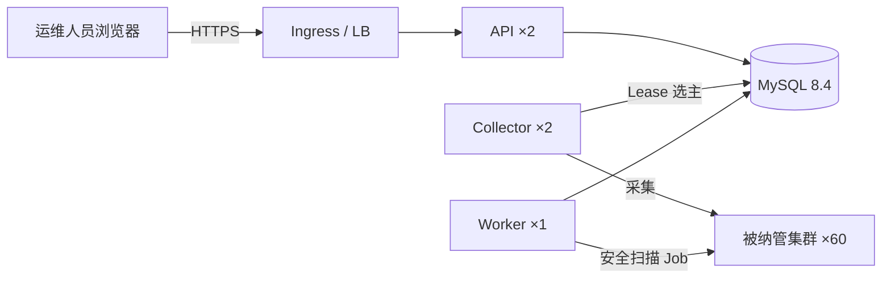

> **历史文档提示**：本文保留的是早期 Token/PXC 生产方案，不能用于当前 `v1.0.1` 首次测试。当前测试交付使用无 Token 单 YAML，请以 [当前安装手册](install.md) 为准。生产 HA MySQL 方案将在测试验收后单独收敛。

# FTC 集群运维平台 · 生产部署手册

面向对象：需要在自有 Kubernetes 集群中部署平台、并在后续纳管 60+ 套集群的运维团队。

本文覆盖从环境准备到上线验证的完整流程，并给出**所有需要外部填写的配置位**。所有待替换项在清单中统一以 `REPLACE_WITH_*` 或 `your-registry.example.com` 标出，部署前用检索确认无残留：

```bash
grep -rn "REPLACE_WITH\|your-registry.example.com" deploy/
```

---

## 目录

1. [部署架构与角色](#1-部署架构与角色)
2. [部署前置检查](#2-部署前置检查)
3. [镜像准备（平台 + 安全扫描双架构）](#3-镜像准备平台--安全扫描双架构)
4. [MySQL 选型与部署](#4-mysql-选型与部署)
5. [平台安装与初始化](#5-平台安装与初始化)
6. [安全扫描权限（被纳管集群侧）](#6-安全扫描权限被纳管集群侧)
7. [配置项全表](#7-配置项全表)
8. [资源规格参考](#8-资源规格参考)
9. [上线验证清单](#9-上线验证清单)
10. [回滚与常见故障](#10-回滚与常见故障)
11. [安全加固建议](#11-安全加固建议)

---

## 1. 部署架构与角色

平台按职责拆成三类进程，可独立扩缩容、独立部署：

| 角色 | `PLATFORM_ROLE` | 职责 | 副本建议 |
|---|---|---|---|
| API | `api` | 对外提供 REST 接口、登录会话、终端通道 | 2（跨可用区） |
| Collector | `collector` | 后台采集健康、容量、资源索引、事件 | 2（Leader 选举保证单活） |
| Worker | `worker` | 执行安全扫描等重任务 | 1 |

三者的边界：

- **只有 API 角色持有用户会话**，Collector/Worker 不需要处理登录。
- **Collector 之间通过 MySQL Lease 选主**（`LEADER_ELECTION_NAME`），同一时刻只有一个 Leader 采集，避免 60 套集群被重复扫描。Leader 切换实测 **304 ms**。
- **Worker 不参与选主**，可以随时重启，正在执行的扫描会记录失败并重试。



---

## 2. 部署前置检查

### 2.1 部署集群（承载平台的那一套）

| 项 | 最低 | 推荐（60 套场景） | 检查命令 |
|---|---|---|---|
| CPU | 8 vCPU | 18 vCPU | `kubectl top nodes` |
| 内存 | 10 GiB | 22 GiB | `kubectl get nodes -o json \| jq '.items[].status.allocatable'` |
| 可用区 | 1 | 3 | `kubectl get nodes -o wide` |
| StorageClass | 支持 RWO | 支持 RWO，SSD/NVMe | `kubectl get storageclass` |
| Kubernetes 版本 | 1.24+ | 1.28+ | `kubectl version` |
| 已有 Ingress | 否 | 是（TLS） | — |

**必须确认集群启用了 `PodSecurityPolicy` 限制或 `PodSecurity` admission**：平台自身的 Pod 不需要特权，但**被纳管集群**里的安全扫描 Job 需要 `privileged`（见第 6 节）。

### 2.2 被纳管集群（60 套目标集群）

单套 200 节点规模的集群建议：

| 项 | 建议值 | 说明 |
|---|---|---|
| 控制面 | 3 副本，8 vCPU / 16 GiB | 平台会持续发起 List 与 watch |
| 节点 | ≥ 200 | 与目标规模一致 |
| 节点架构 | amd64 / arm64 混合 | 混合架构必须配置双架构扫描镜像 |
| 出口网络 | 能拉取 kube-bench 镜像 | 或改用私有仓库 + imagePullSecret |
| Pod Security | 允许 kube-system 建 privileged Job | 见第 6 节 |

### 2.3 客户端工具

`kubectl`（≥ 1.24）、`docker` 或 `nerdctl`（构建与推送镜像）、`openssl`（生成密钥）。

---

## 3. 镜像准备（平台 + 安全扫描双架构）

### 3.1 平台自身镜像

平台是单一二进制 + 内置前端静态资源，**构建一次、多架构通用**。

```bash
# 1. 准备 builder（国内网络务必配置镜像加速，见下方说明）
cat > /tmp/buildkitd.toml <<'EOF'
[registry."docker.io"]
  mirrors = ["docker.m.daocloud.io", "docker.xuanyuan.me"]
EOF

docker buildx rm ftc-builder 2>/dev/null
docker buildx create --name ftc-builder \
  --driver docker-container \
  --driver-opt network=host \
  --config /tmp/buildkitd.toml \
  --use
docker buildx inspect ftc-builder --bootstrap   # 确认 Platforms 含 linux/amd64

# 2. 构建多架构镜像（amd64 + arm64）
docker buildx build \
  --platform linux/amd64,linux/arm64 \
  -t your-registry.example.com/ftc-platform:0.1.0 \
  --push .

# 3. 确认 manifest list 已生成（应看到两个平台）
docker buildx imagetools inspect your-registry.example.com/ftc-platform:0.1.0
```

> **国内网络必须给 buildx 单独配镜像源。** `~/.docker/daemon.json` 里的 `registry-mirrors` 只对 daemon 生效，**docker-container 类型的 builder 不继承它**，会直连 `registry-1.docker.io` 并超时。表现是构建卡在 `load metadata for docker.io/library/node:22-alpine` 后报 `i/o timeout`。
>
> 如果用默认的 `docker` driver（`docker buildx build` 不带 `--builder`），则走 daemon，会自动使用镜像加速。

**只构建 x86_64 单架构镜像**（Apple Silicon 本机构建 x86 镜像）：

```bash
docker buildx build --platform linux/amd64 \
  -t your-registry.example.com/ftc-platform:0.1.0 \
  --load .
```

Go 二进制以 `CGO_ENABLED=0` 交叉编译，**arm64 机器构建 amd64 镜像不需要模拟器或交叉工具链**。但 Dockerfile 里的 `apk add kubectl` 需要对应架构的 alpine 仓库，`--platform linux/amd64` 会自动处理。

> **Go module 与 npm 源同样需要镜像。** `proxy.golang.org` 在国内不可达，Dockerfile 已把 `GOPROXY` 与 `NPM_REGISTRY` 做成构建参数，默认指向 `goproxy.cn` 与 `registry.npmmirror.com`。海外网络请覆盖：
>
> ```bash
> docker buildx build --platform linux/amd64 \
>   --build-arg GOPROXY=https://proxy.golang.org,direct \
>   --build-arg NPM_REGISTRY=https://registry.npmjs.org \
>   -t your-registry.example.com/ftc-platform:0.1.0 --load .
> ```
>
> 仓库也提供了 Makefile 目标：
>
> ```bash
> make build-image-amd64 REGISTRY=your-registry.example.com IMAGE_TAG=0.1.0
> make build-image-multi  REGISTRY=your-registry.example.com IMAGE_TAG=0.1.0
> ```

**验证产出的架构**（务必确认，避免推错镜像到集群）：

```bash
docker image inspect your-registry.example.com/ftc-platform:0.1.0 --format '{{.Architecture}}/{{.Os}}'
# 期望：amd64/linux

# 进一步确认容器内二进制架构与可运行性
docker run --rm --platform linux/amd64 --entrypoint sh \
  your-registry.example.com/ftc-platform:0.1.0 -c 'uname -m; ls -la /app/ftc-platform'
# 期望：x86_64
```

**首次构建耗时较长**（需拉取 node/golang/alpine 三套基础镜像，约 20 分钟），后续构建走缓存通常在 2–5 分钟。

然后替换三处镜像地址：

| 文件 | 位置 |
|---|---|
| `deploy/platform.yaml` | API Deployment |
| `deploy/platform-collector.yaml` | Collector Deployment |
| `deploy/platform-worker.yaml` | Worker Deployment |

### 3.2 安全扫描镜像（双架构，必填项）

平台用 `kube-bench` 做 CIS 节点基线扫描。**平台会按被扫节点的架构自动选镜像**，所以需要两套地址：

| 变量 | 用途 | 留空行为 |
|---|---|---|
| `SECURITY_KUBE_BENCH_IMAGE` | 通用/回退镜像 | 已内置默认值 `docker.io/aquasec/kube-bench:v0.16.0` |
| `SECURITY_KUBE_BENCH_IMAGE_AMD64` | x86_64 节点专用 | 回退到通用镜像 |
| `SECURITY_KUBE_BENCH_IMAGE_ARM64` | aarch64 节点专用 | 回退到通用镜像 |

配置位置：`deploy/platform.yaml` 的 ConfigMap `ftc-platform`（Worker 通过 `envFrom` 引用同一份）。

**生产建议**：把 kube-bench 同步到企业镜像仓库并推成多架构 manifest，然后分别填两个变量：

```bash
# 同步并推送多架构 manifest（示例）
docker buildx build \
  --platform linux/amd64,linux/arm64 \
  -t your-registry.example.com/ftc-kube-bench:v0.16.0 \
  --push docker.io/aquasec/kube-bench:v0.16.0
```

```yaml
# deploy/platform.yaml → ConfigMap ftc-platform
  SECURITY_KUBE_BENCH_IMAGE: your-registry.example.com/ftc-kube-bench:v0.16.0
  SECURITY_KUBE_BENCH_IMAGE_AMD64: your-registry.example.com/ftc-kube-bench:v0.16.0
  SECURITY_KUBE_BENCH_IMAGE_ARM64: your-registry.example.com/ftc-kube-bench:v0.16.0
```

> **只有一个架构的集群**：只填通用镜像即可，两个架构变量留空。
>
> **私有仓库**：`SECURITY_SCANNER_IMAGE_PULL_SECRET` 填被纳管集群中已存在的 imagePullSecret 名称（该 Secret 必须存在于**每个被纳管集群**，且在 `SECURITY_SCANNER_NAMESPACE` 指定的 namespace 内）。

### 3.3 MySQL 镜像

同样支持替换为企业仓库地址，见第 4 节。

---

## 4. MySQL 选型与部署

### 4.1 三种选型

| 方案 | 适用 | 清单 | 高可用 |
|---|---|---|---|
| **A. 外部托管 MySQL** | 生产推荐 | 初始化页面选「集群外 MySQL」 | 由 DBA 负责（云 RDS / 企业现有实例） |
| **B. 集群内 PXC 高可用** | 平台与数据库同集群，要求自持数据 | `deploy/install.yaml` | PXC Operator 三节点 + HAProxy，自动 failover |
| **C. 集群内单副本** | 开发、测试，或可接受短时中断 | `deploy/mysql.yaml` | 无 |

> **强烈建议生产用方案 A**。方案 B 的主从切换需要人工介入，在真实故障中会拉长恢复时间；方案 C 是单点。

### 4.2 平台对 MySQL 的硬性要求

这些是代码层面决定的，**必须满足**，否则会出现时间错乱或字符集问题：

| 要求 | 值 | 来源 |
|---|---|---|
| 字符集 | `utf8mb4` | DSN 参数 `charset=utf8mb4` |
| 排序规则 | `utf8mb4_0900_ai_ci` | 清单已内置 |
| 时区 | UTC | DSN `loc=UTC` + 清单 `--default-time-zone=+00:00` |
| 版本 | MySQL 8.0+（推荐 8.4） | `utf8mb4_0900_ai_ci` 需 8.0+ |
| `max_connections` | ≥ 100 | 平台侧事件库连接池 20，其他若干 |
| `max_allowed_packet` | ≥ 64M | 大批���写入 |
| 权限 | 建表/建索引/读写 | 平台启动时自动迁移 |

**字符集不一致的后果**：MySQL 端是 `utf8mb3` 而 DSN 声明 `utf8mb4`，写入中文会出现 `Incorrect string value`。**时区不一致**会导致事件时间戳整体偏移，且不会报错——这类问题在生产上极难排查。

### 4.3 容量估算

事件是主要增长项。按 ADR-0009 的预算 `100 次/秒`：

| 保留期 | 估算行数 | 磁盘（含索引与 binlog） |
|---|---|---|
| 7 天 | 6,048 万 | 30–50 GiB |
| 30 天 | 2.6 亿 | 120–200 GiB |
| 90 天 | 7.8 亿 | 350–600 GiB |

> 事件表按 `event_uid` 幂等更新，实际行数取决于集群事件密度而非更新次数。**首次上线建议按 30 天规划，并开启慢查询日志**（清单已配 `long_query_time=1`）观察真实增速。

### 4.4 部署集群内 MySQL（方案 B / C）

```bash
# 1. 替换占位符
#    - 镜像地址
#    - root 密码、应用密码、复制密码
#    - REPLACE_WITH_STORAGE_CLASS
# 2. 部署
kubectl apply -n ftc-platform -f deploy/install.yaml   # 方案 B
# 或
kubectl apply -f deploy/mysql.yaml      # 方案 C

# 3. 等待就绪
kubectl -n ftc-platform rollout status statefulset/platform-mysql --timeout=5m
kubectl -n ftc-platform get pod,svc,pvc
```

预期：`platform-mysql-0/1` 为 `1/1 Running`，Service `platform-mysql` 与 `platform-mysql-primary` 存在，PVC 为 `Bound`。

**方案 B 的从库初始化**（首次部署需执行一次）：

```bash
# 在主库上创建复制账号并记录 binlog 位点
kubectl -n ftc-platform exec platform-mysql-0 -- mysql -uroot -p"$ROOT_PASSWORD" \
  -e "CREATE USER 'repl'@'%' IDENTIFIED BY 'REPL_PASSWORD';
      GRANT REPLICATION SLAVE, REPLICATION CLIENT ON *.* TO 'repl'@'%';
      FLUSH PRIVILEGES; SHOW MASTER STATUS;"

# 用上一步的 File/Position 初始化从库
kubectl -n ftc-platform exec platform-mysql-replica-0 -- mysql -uroot -p"$ROOT_PASSWORD" \
  -e "CHANGE REPLICATION SOURCE TO
      SOURCE_HOST='platform-mysql-primary.ftc-platform.svc',
      SOURCE_USER='repl', SOURCE_PASSWORD='REPL_PASSWORD',
      SOURCE_LOG_FILE='<File>', SOURCE_LOG_POS=<Position>;
      START REPLICA;"

# 验证
kubectl -n ftc-platform exec platform-mysql-replica-0 -- mysql -uroot -p"$ROOT_PASSWORD" \
  -e "SHOW REPLICA STATUS\G" | grep -E "Replica_IO_Running|Replica_SQL_Running"
```

两条都应为 `Yes`。若从库已用 `--read-only=ON` 启动，`START REPLICA` 会因只读事务失败——先 `SET GLOBAL read_only=OFF` 再启动复制。

### 4.5 备份与恢复

```bash
kubectl apply -f deploy/mysql-backup.yaml
```

每日 02:00 备份，保留 7 天。**恢复流程**：

```bash
# 1. 停平台（避免恢复期间写入）
kubectl -n ftc-platform scale deployment ftc-platform --replicas=0
kubectl -n ftc-platform scale deployment ftc-platform-collector --replicas=0

# 2. 恢复
kubectl -n ftc-platform exec platform-mysql-0 -- sh -c \
  'gunzip < /backup/ftc_platform-YYYYMMDDHHMMSS.sql.gz | mysql -uroot -p"$MYSQL_ROOT_PASSWORD" ftc_platform'

# 3. 起平台
kubectl -n ftc-platform scale deployment ftc-platform --replicas=2
kubectl -n ftc-platform scale deployment ftc-platform-collector --replicas=2
```

> `ftc-platform-runtime` Secret 与数据库同等重要：它保存数据库 DSN 和管理员密码哈希。丢失后平台会回到初始化模式，而数据库已有管理员时初始化会被拒绝。**必须纳入 Secret 备份。**

---

## 5. 平台安装与初始化

### 5.1 生成密钥

```bash
# 凭据加密密钥：32 字节的 Base64（必须是 32 字节，否则启动失败）
openssl rand -base64 32

# 初始化凭证：至少 16 字符（平台会拒绝占位符和过短的值）
openssl rand -hex 24
```

### 5.2 填写配置

编辑 `deploy/platform.yaml`：

```yaml
# 1) ConfigMap ftc-platform
  SECURITY_KUBE_BENCH_IMAGE: your-registry.example.com/ftc-kube-bench:v0.16.0
  SECURITY_KUBE_BENCH_IMAGE_AMD64: your-registry.example.com/ftc-kube-bench:v0.16.0
  SECURITY_KUBE_BENCH_IMAGE_ARM64: your-registry.example.com/ftc-kube-bench:v0.16.0

# 2) Secret ftc-platform
  encryption-key: <第 5.1 步生成的 Base64>
  setup-token: <第 5.1 步生成的 hex>

# 3) Deployment 镜像
  image: your-registry.example.com/ftc-platform:0.1.0
```

若使用集群内 MySQL，`SETUP_DEFAULT_DB_HOST` 保持默认 `platform-mysql.ftc-platform.svc`；若用外部 MySQL，在初始化页面填写即可。

### 5.3 部署

```bash
kubectl apply -f deploy/platform.yaml
kubectl -n ftc-platform rollout status deployment/ftc-platform --timeout=5m
kubectl -n ftc-platform get pod,svc
```

初始 Pod 以 `SETUP_MODE=true` 运行，不连接数据库，`/api/v1/health` 可用（就绪探针因此正常）。

**建议同时部署 Collector 与 Worker**（60 套规模必需）：

```bash
kubectl apply -f deploy/platform-collector.yaml
kubectl apply -f deploy/platform-worker.yaml
```

### 5.4 完成初始化

浏览器访问平台（生产走 Ingress，验证可端口转发）：

```bash
kubectl -n ftc-platform port-forward svc/ftc-platform 8080:80
# 浏览器打开 http://127.0.0.1:8080
```

页面步骤：

1. 选择数据库方式：「随平台部署在集群内」或「连接集群外 MySQL」
2. 填写地址、端口、库名、账号、密码
3. 填写初始化凭证（`setup-token`）与管理员用户名/密码（≥12 字符）
4. 先点「测试连接」，再点「初始化数据库」

平台会：连接 MySQL → 建全部表与索引 → 创建管理员 → 把 DSN 与管理员哈希写入 `ftc-platform-runtime` Secret → 自动退出并重启。

```bash
kubectl -n ftc-platform rollout status deployment/ftc-platform
kubectl -n ftc-platform get secret ftc-platform-runtime
kubectl -n ftc-platform logs deployment/ftc-platform --tail=100
```

### 5.5 可选加固：初始化用独立 ServiceAccount

`ftc-platform` ServiceAccount **不含 Secret 权限**（凭据全部由 `env` 注入，运行期不需要 API 读）。只有 setup 模式需要写 `ftc-platform-runtime`。

若要彻底隔离，初始化前后切换 roleRef：

```bash
# 初始化前
kubectl -n ftc-platform patch serviceaccount ftc-platform \
  -p '{"roleRef":{"kind":"Role","name":"ftc-platform-setup","apiGroup":"rbac.authorization.k8s.io"}}'
# 初始化完成、进入正常运行后
kubectl -n ftc-platform patch serviceaccount ftc-platform \
  -p '{"roleRef":{"kind":"Role","name":"ftc-platform-leader-election","apiGroup":"rbac.authorization.k8s.io"}}'
```

> 平台**不会自动改 roleRef**——那需要 `serviceaccounts/patch` 权限，本身即扩大攻击面。这一步应由运维流程或 GitOps 保证。
>
> 不做这一步也能正常初始化：此时 API Pod 用的是 `ftc-platform` 角色，它在 setup 模式下仍能通过 `env` 读取注入的 Secret。切换的价值在于**长期运行阶段**任何 Pod 都无法通过 API 读取 DSN 与加密密钥。

---

## 6. 安全扫描权限（被纳管集群侧）

平台在**被纳管集群**里创建临时 kube-bench Job 做 CIS 节点基线扫描。这要求被纳管集群满足：

### 6.1 Job 的运行形态

| 属性 | 值 | 原因 |
|---|---|---|
| namespace | `SECURITY_SCANNER_NAMESPACE`（默认 `kube-system`） | 需能建 Job |
| privileged | 是 | 读取容器运行时 socket |
| runAsUser | 0 | 访问主机文件 |
| hostPID | 是 | 感知主机进程 |
| hostPath 挂载 | `/etc`、`/var`、`/lib/systemd`、`/usr/bin`（只读） | CIS 基线数据来源 |
| SA token | 不挂载 | 扫描 Pod 不需要访问 API |

### 6.2 被纳管集群需要的 RBAC

在**每个被纳管集群**的 `SECURITY_SCANNER_NAMESPACE` 中执行：

```yaml
apiVersion: rbac.authorization.k8s.io/v1
kind: Role
metadata:
  name: ftc-platform-scanner
  namespace: kube-system
rules:
  - apiGroups: ["batch"]
    resources: ["jobs"]
    verbs: ["get", "list", "watch", "create", "delete", "deletecollection"]
  - apiGroups: [""]
    resources: ["pods"]
    verbs: ["get", "list", "watch", "delete"]
  - apiGroups: [""]
    resources: ["pods/log"]
    verbs: ["get"]
---
apiVersion: rbac.authorization.k8s.io/v1
kind: RoleBinding
metadata:
  name: ftc-platform-scanner
  namespace: kube-system
subjects:
  - kind: User
    name: <平台在目标集群使用的 ServiceAccount 或用户账号>
roleRef:
  apiGroup: rbac.authorization.k8s.io
  kind: Role
  name: ftc-platform-scanner
```

> **注意**：上例是「平台在目标集群的凭据」需要的权限。如果平台用管理员 kubeconfig 纳管，则无需额外配置；用只读 ServiceAccount 纳管时必须授予以上权限，否则扫描会失败并提示 `Job ... 的扫描 Pod 在 ... 内未能启动`。

### 6.3 Pod Security 限制

若目标集群启用了 `PodSecurity` 的 `restricted` 策略，扫描 Job 会被拒绝。需要：

```yaml
# 在 kube-system 命名空间放宽（示例）
apiVersion: pod-security.kubernetes.io/v1beta1
kind: Namespace
metadata:
  name: kube-system
  labels:
    pod-security.kubernetes.io/enforce: privileged
```

或者把 `SECURITY_SCANNER_NAMESPACE` 指向一个专门放行 `privileged` 的独立 namespace。

### 6.4 私有仓库拉取

在**每个被纳管集群**创建 imagePullSecret，并把名称填入平台的 `SECURITY_SCANNER_IMAGE_PULL_SECRET`：

```bash
kubectl -n kube-system create secret docker-registry ftc-scanner-pull \
  --docker-server=your-registry.example.com \
  --docker-username='<user>' --docker-password='<password>'
```

---

## 7. 配置项全表

平台共识别 56 个环境变量。下表按用途分组，**加粗**为通常需要改的。

### 7.1 数据库

| 变量 | 默认 | 说明 |
|---|---|---|
| `PLATFORM_DATABASE_DSN` | 空 | 完整 DSN，**优先级最高**。设置后忽略下面几项 |
| `PLATFORM_DB_HOST` | 空 | 数据库地址（与 PORT/USER/PASSWORD/NAME 组合使用） |
| `PLATFORM_DB_PORT` | 3306 | 端口 |
| `PLATFORM_DB_USER` | 空 | 账号 |
| `PLATFORM_DB_PASSWORD` | 空 | 密码 |
| `PLATFORM_DB_NAME` | 空 | 库名 |
| `PLATFORM_DB_TLS` | 空 | TLS 配置：`true` / `skip-verify` / 自定义名 |
| `EVENT_DATABASE_DSN` | 空 | 事件库独立 DSN（不设则与主库同库） |

> DSN 构造固定为 `charset=utf8mb4`、`parseTime=true`、`loc=UTC`。**MySQL 侧必须匹配**（见 4.2）。

### 7.2 角色与监听

| 变量 | 默认 | 说明 |
|---|---|---|
| `PLATFORM_ROLE` | `all` | `api` / `collector` / `worker` / `all` |
| `LISTEN_ADDR` | `:8080` | API 监听地址 |
| `METRICS_ADDR` | `:9090` | Prometheus 指标地址 |
| `WEB_DIST_DIR` | 空 | 前端静态资源目录 |
| `LEADER_ELECTION_ENABLED` | `true` | Collector 是否选主 |
| `LEADER_ELECTION_NAME` | `ftc-platform-collectors` | Lease 名称 |
| `POD_NAMESPACE` | 空 | 当前 Pod 所在 namespace（setup 用） |
| `BOOTSTRAP_TOKEN_PATH` | `./data/bootstrap-token` | 首次启动令牌落盘路径 |

### 7.3 认证与会话

| 变量 | 默认 | 说明 |
|---|---|---|
| `ADMIN_USERNAME` | `admin` | 初始管理员名 |
| `ADMIN_PASSWORD_HASH` | 空 | 管理员 bcrypt 哈希（可跳过初始化页） |
| `SETUP_MODE` | `false` | 是否处于初始化模式 |
| `SETUP_TOKEN` | 空 | 初始化凭证，**≥16 字符且不能是占位符** |
| `SETUP_DEFAULT_DB_HOST` | `platform-mysql.ftc-platform.svc` | 初始化页默认地址 |
| `SETUP_DEFAULT_DB_NAME` | `ftc_platform` | 初始化页默认库名 |
| `SETUP_RUNTIME_SECRET` | `ftc-platform-runtime` | 运行时 Secret 名 |
| `SESSION_TTL` | `8h` | 会话有效期 |
| `SECURE_COOKIES` | `true` | Cookie 的 Secure 标记（生产 HTTPS 必须为 true） |
| `ALLOW_LOOPBACK_WS_ORIGIN` | `false` | **仅本地开发**，允许 loopback 跨端口 WebSocket |
| `TRUST_PROXY_HEADERS` | `false` | 信任 `X-Forwarded-For`（仅当有可信代理时开启） |
| `ENABLE_POD_EXEC` | `true` | 是否允许 Pod 终端；纳管凭据仍需具有 `pods/exec` 权限 |
| `DATABASE_PATH` | `./data/platform.db` | SQLite 路径（仅单角色本地模式） |

### 7.4 安全扫描

| 变量 | 默认 | 说明 |
|---|---|---|
| **`SECURITY_KUBE_BENCH_IMAGE`** | `docker.io/aquasec/kube-bench:v0.16.0` | 通用/回退镜像 |
| **`SECURITY_KUBE_BENCH_IMAGE_AMD64`** | 空 | x86_64 节点专用镜像 |
| **`SECURITY_KUBE_BENCH_IMAGE_ARM64`** | 空 | aarch64 节点专用镜像 |
| `SECURITY_SCANNER_NAMESPACE` | `kube-system` | 扫描 Job 所在 namespace |
| `SECURITY_SCANNER_IMAGE_PULL_SECRET` | 空 | 私有仓库拉取凭据名 |
| `SECURITY_SCAN_WORKERS` | `2` | 集群侧扫描并发 |
| `SECURITY_HOST_SCAN_WORKERS` | `5` | 节点级扫描并发 |
| `SECURITY_SCAN_TIMEOUT` | `30m` | 单次扫描超时 |
| `SECURITY_POD_STARTUP_TIMEOUT` | `5m` | 扫描 Pod 启动等待 |

### 7.5 采集

| 变量 | 默认 | 说明 |
|---|---|---|
| `HEALTH_COLLECTION_INTERVAL` | `1m` | 健康采集周期 |
| `HEALTH_COLLECTION_TIMEOUT` | `20s` | 单集群健康超时 |
| `HEALTH_COLLECTION_WORKERS` | `5` | 健康采集并发 |
| `HEALTH_INSTANCE_SOURCE` | `pods` | 实例数来源：`pods` / `workloads`（分片采集须为 `workloads`） |
| `CAPACITY_COLLECTION_INTERVAL` | `5m` | 容量采集周期 |
| `CAPACITY_COLLECTION_TIMEOUT` | `45s` | 单集群容量超时 |
| `CAPACITY_COLLECTION_WORKERS` | `3` | 容量采集并发 |
| `RESOURCE_INDEX_INTERVAL` | `10m` | 资源索引周期 |
| `RESOURCE_INDEX_TIMEOUT` | `30s` | 单集群索引超时 |
| `RESOURCE_INDEX_WORKERS` | `2` | 索引采集并发 |
| `COLLECTION_SHARDS` | `0` | 分片数，0 为不分片。**分片需共享 MySQL 且 `HEALTH_INSTANCE_SOURCE=workloads`** |
| `SYSTEM_NAMESPACES` | `kube-system,cmb-monitoring` | 视为系统组件的 namespace（不计入业务容量） |

### 7.6 接口并发

| 变量 | 默认 | 说明 |
|---|---|---|
| `HTTP_QUERY_CONCURRENCY` | `64` | 查询类并发槽位 |
| `HTTP_REALTIME_CONCURRENCY` | `20` | 实时类并发槽位 |
| `HTTP_MONITORING_CONCURRENCY` | `8` | 监控类并发槽位 |
| `HTTP_SESSION_CONCURRENCY` | `10` | 终端会话并发槽位 |
| `HTTP_CLUSTER_CONCURRENCY` | `2` | 单集群并发槽位（**限制对同一集群的并发压测**） |

> 这些是**准入闸门**而非线程池大小。超出的请求会排队等待，而不是堆积。终端会话默认上限 10，对应 10-15 人并发使用的设计目标。

---

## 8. 资源规格参考

### 8.1 最低可运行（60 套 × 200 节点）

| 角色 | 副本 | requests | limits |
|---|---|---|---|
| API | 2 | 1 CPU / 1 GiB | 2 CPU / 2 GiB |
| Collector | 2 | 2 CPU / 2 GiB | 4 CPU / 4 GiB |
| Worker | 1 | 1 CPU / 1 GiB | 2 CPU / 2 GiB |
| MySQL | 1 | 2 CPU / 4 GiB | 4 CPU / 8 GiB |

**合计约 8 vCPU / 10 GiB / 100 GiB SSD**

### 8.2 推荐（100 套验证规模，留余量）

| 角色 | 副本 | requests | limits |
|---|---|---|---|
| API | 2 | 2 CPU / 2 GiB | 4 CPU / 4 GiB |
| Collector | 2 | 4 CPU / 4 GiB | 8 CPU / 8 GiB |
| Worker | 1 | 2 CPU / 2 GiB | 4 CPU / 4 GiB |
| MySQL | 1（建议 HA） | 4 CPU / 8 GiB | 8 CPU / 16 GiB |

**合计约 18 vCPU / 22 GiB**

### 8.3 规格依据

来自 `data/scale-reports/mysql-100.json`（100 集群 × 200 节点 × 6000 Pod 实测）：

| 指标 | 实测值 |
|---|---|
| 峰值 Go 堆 | 160 MB |
| 峰值 goroutine | 1533 |
| List 请求 / 对象 | 8082 次 / 239 万 |
| 故障接管耗时 | 304 ms |
| 冷启动预热 | 约 4.7 分钟 |

> **冷启动 4.7 分钟**不是缺陷：100 套集群首次索引需要时间。建议首批纳管时用 `cmd/fleetload` 分批预热，或接受这段爬坡期。

> **这份数据的边界**（报告自身的 `not_verified` 字段）：未验证 24 小时稳定性、真实 200 节点 API Server 与 Prometheus、事件风暴、10 个真实终端会话、浏览器渲染。**合成压测通过 ≠ 生产验证通过。** 上线前建议补一次真实集群 24 小时混合负载验证。

### 8.4 内存要点

- Collector 是内存大户（需解码 200 节点/6000 Pod 对象），**limits 内存至少给 requests 的 2 倍**，让 GC 有余量。
- 不要设置比 limits 更紧的 `GOMEMLIMIT`；Go 需要堆外内存做 TLS 与连接池。
- MySQL 的 `innodb_buffer_pool_size` 建议为 MySQL 内存的 60%。

---

## 9. 上线验证清单

### 9.1 基础可用性

```bash
# 健康与版本
kubectl -n ftc-platform port-forward svc/ftc-platform 8080:80 &
curl -s http://127.0.0.1:8080/api/v1/health
curl -s http://127.0.0.1:8080/api/v1/version

# 指标
curl -s http://127.0.0.1:9090/metrics | grep -E "platform_collection_shards_owned|platform_clusters_total"
```

### 9.2 采集链路

```bash
# Leader 只有一个（Collector 日志）
kubectl -n ftc-platform logs deployment/ftc-platform-collector --tail=200 | grep "became leader"

# 采集状态变为 watching
# 平台页面打开任意已纳管集群的「事件」页
```

关键指标：

| 指标 | 期望 |
|---|---|
| `platform_collection_shards_owned` | 等于分片数（未分片时为 0） |
| `platform_collection_lease_errors_total` | 稳定不增长 |
| `platform_clusters_total` | 等于已纳管集群数 |

### 9.3 功能验证

- [ ] 登录、登出、改密
- [ ] 纳管一套测试集群，填写 kubeconfig
- [ ] 集群列表、节点、Pod、工作负载页面正常
- [ ] 事件页有数据且时间正确（**验证时区**）
- [ ] 容量页与基线数据正常
- [ ] 全局搜索能命中（注意：修复后 `_` 是字面量，搜 `web_01` 不会匹配 `web-01`）
- [ ] 安全扫描能完成并产出报告（验证第 6 节权限）
- [ ] Pod 终端（`ENABLE_POD_EXEC=true` 时）

### 9.4 数据一致性抽查

```sql
-- 事件时间戳是否在合理范围（验证时区与时钟）
SELECT MAX(last_observed_at), MIN(last_observed_at) FROM cluster_events;

-- 表行数与索引状态
SELECT table_name, table_rows, ROUND(data_length/1048576) AS data_mb,
       ROUND(index_length/1048576) AS index_mb
FROM information_schema.tables
WHERE table_schema = 'ftc_platform' ORDER BY data_length+index_length DESC;
```

### 9.5 性能基线

用 `cmd/fleetscale` 跑一次合成压测，与生产配置对齐（副本数、并发槽位）：

```bash
go run ./cmd/fleetscale --clusters 60 --nodes 200 --pods 6000 --database mysql
```

关注 P95/P99 与 `peak_go_heap_alloc_bytes`。**与本机基线对比出现数量级差异时，先查并发槽位是否被调小。**

---

## 10. 回滚与常见故障

### 10.1 回滚

| 场景 | 操作 |
|---|---|
| 平台版本问题 | 改回旧镜像 tag → `kubectl rollout undo deployment/ftc-platform` |
| 配置问题 | `kubectl -n ftc-platform edit configmap ftc-platform` → 触发滚动重启 |
| 初始化后回退 | 删 `ftc-platform-runtime` Secret + 清库 → 重新初始化（**会丢数据**） |
| 采集异常 | 缩容 Collector 至 0，平台其余功能不受影响 |

```bash
# 一键回滚镜像
kubectl -n ftc-platform set image deployment/ftc-platform platform=your-registry.example.com/ftc-platform:0.0.9
```

### 10.2 常见故障

| 现象 | 原因 | 处理 |
|---|---|---|
| 启动报 `credential encryption key must be base64-encoded 32 bytes` | 密钥长度不对 | `openssl rand -base64 32` 重新生成 |
| 启动报 `SETUP_TOKEN is required` | setup 模式未给凭证 | 填 ≥16 字符的非占位符 |
| 启动报 `setup token still uses the example placeholder` | 用了清单默认值 | 换成随机值 |
| 启动报 `split roles require PLATFORM_DATABASE_DSN` | 拆角色但没给 DSN | 先完成初始化 |
| 启动报 `sharded collection requires shared MySQL` | 分片模式用了 SQLite | 指定 MySQL DSN |
| 启动报 `sharded collection requires HEALTH_INSTANCE_SOURCE=workloads` | 分片模式配置不符 | 改为 `workloads` |
| 事件页面时间整体偏移 | **MySQL 时区不是 UTC** | MySQL 加 `--default-time-zone=+00:00` 并重启 |
| 中文写入报 `Incorrect string value` | MySQL 字符集不是 utf8mb4 | 改字符集并重建库 |
| 扫描 Job 起不来 | 缺 RBAC / Pod Security / hostPath | 见第 6 节与扫描提示 |
| 扫描提示镜像拉取失败 | 目标集群拉不到外网镜像 | 配私有仓库 + `SECURITY_SCANNER_IMAGE_PULL_SECRET` |
| 终端连不上 | `ENABLE_POD_EXEC=false` 或 Session 不足 | 开启开关；调大 `HTTP_SESSION_CONCURRENCY` |
| 登录被限流 | 15 分钟内同 IP 失败 20 次 | 等待或从可信代理后访问（`TRUST_PROXY_HEADERS`） |
| 页面 403 | 角色不足 | viewer 只能读；写操作需 operator/admin |
| PVC Pending | StorageClass 不存在或容量不足 | 填对 `storageClassName`，确认容量 |

### 10.3 排障入口

```bash
# 平台日志
kubectl -n ftc-platform logs deployment/ftc-platform --tail=200
kubectl -n ftc-platform logs deployment/ftc-platform-collector --tail=200
kubectl -n ftc-platform logs deployment/ftc-platform-worker --tail=200

# 事件描述（已脱敏，不含 API Server 地址）
kubectl -n ftc-platform logs deployment/ftc-platform-worker | grep "security scan detail"

# MySQL 慢查询
kubectl -n ftc-platform exec platform-mysql-0 -- \
  mysql -uroot -p"$PW" -e "SHOW VARIABLES LIKE 'slow_query_log'; SHOW GLOBAL STATUS LIKE 'Slow_queries';"
```

---

## 11. 安全加固建议

按优先级排序，前三项是**必须做**：

| 优先级 | 项 | 说明 |
|---|---|---|
| **必须** | 替换所有 `REPLACE_WITH_*` | 平台会拒绝占位符 setup token，但数据库密码不会 |
| **必须** | `SECURE_COOKIES=true` + HTTPS Ingress | 生产必须走 HTTPS |
| **必须** | `ALLOW_LOOPBACK_WS_ORIGIN=false` | 开启等于允许本机任意页面驱动你的终端 |
| **必须** | 加密密钥纳入密钥管理系统 | 丢失则所有集群凭据不可解 |
| 建议 | `TRUST_PROXY_HEADERS` 仅在有可信代理时开 | 开启前确认代理会覆盖该头，否则可被伪造绕过限流 |
| 建议 | 初始化后切换 setup roleRef | 见 5.5 |
| 建议 | 被纳管集群用最小权限 SA | 见第 6 节 |
| 建议 | 平台自身 Pod 加 `resourceQuota` 与 `LimitRange` | 防止意外超卖 |
| 建议 | MySQL 备份异地留存 | 单 PVC 备份扛不住节点级故障 |
| 建议 | 调大上传上限时同步调大 `max_allowed_packet` | 文件内容存放在平台数据库中，包大小超过 MySQL 限制会写入失败 |
| 建议 | 调大上传上限后核对 Ingress 的 `proxy-body-size` | 该注解由 setup 按初始上限生成；参数页调大后需同步更新 Ingress，否则代理会先返回 413 |
| 可选 | 审计平台自身操作 | 平台已有会话与安全基线历史记录 |

### 11.1 平台已内置的安全能力

无需额外配置，平台代码层面已实现：

- 凭据 AES-256-GCM 加密存储，且**密文与 clusterID 绑定**（密文无法跨集群搬运）
- kubeconfig 强制 HTTPS、强制内嵌 CA、拒绝 `insecure-skip-tls-verify`、拒绝 exec 插件与 basic auth
- 登录限流（IP + 账号双维度），会话令牌 32 字节随机，bcrypt cost=12
- 权限按路由显式声明，新增状态变更路由若未声明则**启动即失败**
- 集群资源名单名校验（阻断 `../` 路径穿越）
- 采集分页限额（每页 500 / 总 25000 / 单页 8 MiB）与跨页 RV 一致性校验
- 扫描结果与错误信息脱敏，不外泄 API Server 地址与凭据

---

## 附录：相关文档

| 文档 | 用途 |
|---|---|
| `docs/deployment/kubernetes.md` | 部署步骤（精简版） |
| `docs/adr/0009-fleet-collection-architecture-at-scale.md` | 60 套集群采集架构决策 |
| `docs/adr/0001-persist-kubernetes-events-in-mysql.md` | 事件入库设计 |
| `docs/adr/0003-kubernetes-ha-and-unified-mysql.md` | HA 与统一 MySQL 决策 |
| `data/scale-reports/mysql-100.json` | 100×200×6000 实测报告 |
