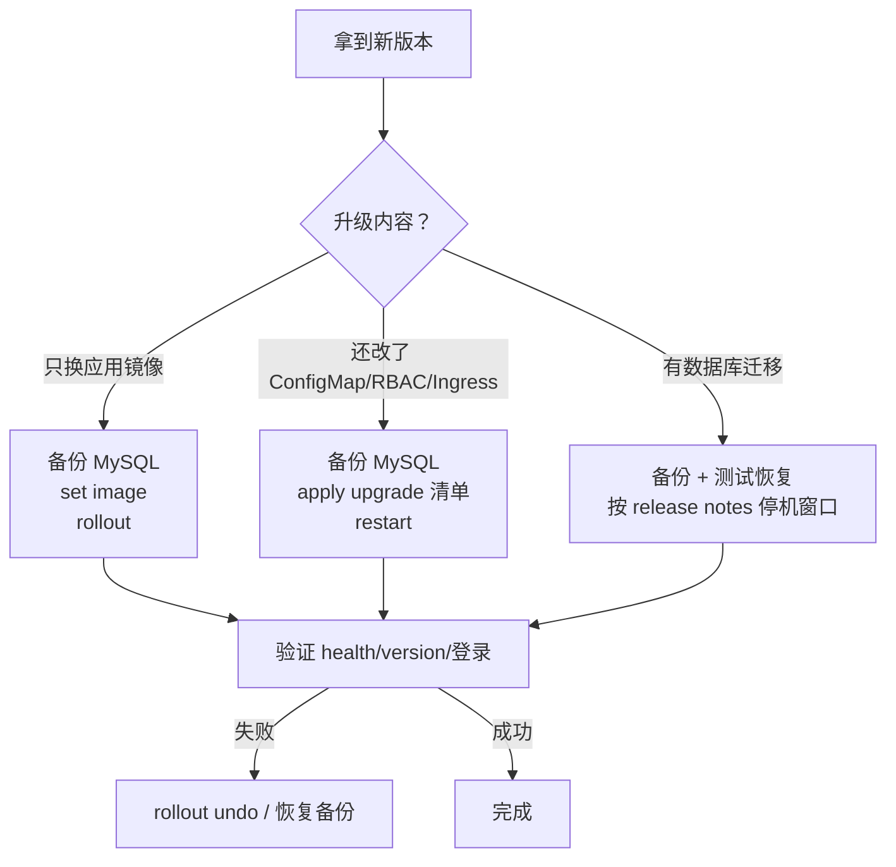

# FTC 平台升级手册（外部 MySQL · 无 Helm）

> 适用于已经按 [外部 MySQL 交付手册](install.md) 安装完成的平台。  
> 当前版本**没有自动升级控制器**，升级通过“备份 → 替换镜像/应用升级清单 → 验证”完成。不要重新执行首次安装的 `install.yaml`。

---

## 0. 先判断升级类型



**三类升级：**

1. **只换应用镜像**：最常见，平台 Go 二进制更新，数据库结构不变或自动迁移。
2. **应用 + 清单变更**：新增 ConfigMap、RBAC、Ingress、环境变量。
3. **数据库迁移**：新版本增加表/字段/索引；必须按 release notes 处理，通常需要停机窗口。

---

## 1. 版本化交付物（发布方要做）

不要用同一个 `install.yaml` 覆盖所有版本。建议每个版本固定产物：

```text
release/
  v0.2.0/
    install.yaml                  # 全新安装用
    upgrade-from-0.1.0.yaml       # 已安装实例升级用（只含变更资源）
    images.txt                    # 镜像 + digest
    checksums.txt
    RELEASE.md                    # 变更、迁移、兼容性、回滚说明
```

原则：

- `install.yaml` 只给**新集群**首次安装；
- `upgrade-from-<old>-to-<new>.yaml` 只包含本次变更的 ConfigMap/RBAC/Ingress/Deployment 补丁；
- **不要**把 bootstrap Job、bootstrap Secret、setup Deployment/Service、NodePort 30080 放进升级清单；
- 镜像用不可变 tag（版本号或 git sha），记录 digest；
- 升级前在测试环境跑一遍 N-1 → N。

---

## 2. 升级前检查清单

- [ ] 已阅读新版本 `RELEASE.md`，确认是否有数据库迁移、配置变更、Ingress 变更；
- [ ] 已做 MySQL 全量备份，并在测试库验证可恢复；
- [ ] 已记录当前镜像和 digest；
- [ ] 已确认新镜像支持目标节点架构（amd64/arm64）；
- [ ] 已确认节点资源足够滚动更新；
- [ ] 已确认 `ftc-platform-setup` Service 已删除、30080 不监听；
- [ ] 已确认 `ftc-platform-runtime`、`ftc-platform-ca`、`ftc-platform-tls` 不会在升级中删除；
- [ ] 已安排变更窗口和回滚负责人。

### 备份命令示例

```bash
mysqldump \
  --single-transaction --routines --triggers --events \
  -h mysql.internal -P 3306 -u ftc -p \
  ftc_platform > ftc_platform-$(date +%Y%m%d-%H%M).sql
```

> 建议同时保留 binlog/增量备份。迁移失败时，恢复备份通常是唯一可靠的回滚方式。

### 记录当前版本

```bash
kubectl -n ftc-platform get deployment \
  ftc-platform ftc-platform-collector ftc-platform-worker \
  -o jsonpath='{range .items[*]}{.metadata.name}{"\t"}{.spec.template.spec.containers[0].image}{"\n"}{end}'

curl -s https://ftc-platform.cmb.local/api/v1/version
```

---

## 3. 场景 A：只更新应用镜像

### 3.1 推送新镜像

```bash
docker build -t registry.example.com/ftc/ftc-platform:0.2.0 .
docker push registry.example.com/ftc/ftc-platform:0.2.0
```

多架构：

```bash
docker buildx build \
  --platform linux/amd64,linux/arm64 \
  -t registry.example.com/ftc/ftc-platform:0.2.0 \
  --push .
```

### 3.2 更新三个 Deployment

三个 Deployment 的容器名都是 `platform`：

```bash
kubectl -n ftc-platform set image deployment/ftc-platform \
  platform=registry.example.com/ftc/ftc-platform:0.2.0

kubectl -n ftc-platform set image deployment/ftc-platform-collector \
  platform=registry.example.com/ftc/ftc-platform:0.2.0

kubectl -n ftc-platform set image deployment/ftc-platform-worker \
  platform=registry.example.com/ftc/ftc-platform:0.2.0
```

### 3.3 等待滚动更新

```bash
kubectl -n ftc-platform rollout status deployment/ftc-platform --timeout=10m
kubectl -n ftc-platform rollout status deployment/ftc-platform-collector --timeout=10m
kubectl -n ftc-platform rollout status deployment/ftc-platform-worker --timeout=10m
```

如果新版本包含数据库迁移，API 启动时可能先执行迁移；期间 API 可能短暂不可用，属于正常。

---

## 4. 场景 B：还有 ConfigMap/RBAC/Ingress 变更

### 4.1 先应用升级清单

```bash
kubectl apply -f release/v0.2.0/upgrade-from-0.1.0.yaml
```

升级清单**不要**包含：

- `ftc-platform-bootstrap` Job；
- `ftc-platform-bootstrap` Secret；
- `ftc-platform-setup` Deployment/Service；
- `ftc-platform-setup` NodePort 30080；
- 首次安装才创建的 Namespace。

### 4.2 ConfigMap/环境变量变更后重启

```bash
kubectl -n ftc-platform rollout restart deployment/ftc-platform
kubectl -n ftc-platform rollout restart deployment/ftc-platform-collector
kubectl -n ftc-platform rollout restart deployment/ftc-platform-worker
```

### 4.3 Ingress/TLS 变更

- 平台不会在升级时自动重新签发 CA；
- 如果新版本修改 Ingress 规则，只 apply Ingress 资源；
- 保留 `ftc-platform-tls`、`ftc-platform-ca`；
- 修改域名需要同时更新 Ingress host、证书 SAN 和客户端 hosts/DNS。

---

## 5. 场景 C：有数据库迁移

### 5.1 迁移何时执行

当前版本在 API 启动时打开外部 MySQL 并执行 schema migration，迁移带数据库锁，避免多个 API 副本同时迁移。

### 5.2 推荐顺序

1. 备份 MySQL，验证恢复；
2. 如 release notes 说明迁移不向后兼容：
   ```bash
   kubectl -n ftc-platform scale deployment/ftc-platform-worker --replicas=0
   kubectl -n ftc-platform scale deployment/ftc-platform-collector --replicas=0
   ```
3. 更新 API：
   ```bash
   kubectl -n ftc-platform set image deployment/ftc-platform \
     platform=registry.example.com/ftc/ftc-platform:0.2.0
   kubectl -n ftc-platform rollout status deployment/ftc-platform --timeout=10m
   ```
4. 检查 API 日志和 `/api/v1/health`；
5. 先把 Worker/Collector 的镜像改好（此时仍为 0 副本），再恢复副本：
   ```bash
   kubectl -n ftc-platform set image deployment/ftc-platform-collector \
     platform=registry.example.com/ftc/ftc-platform:0.2.0
   kubectl -n ftc-platform set image deployment/ftc-platform-worker \
     platform=registry.example.com/ftc/ftc-platform:0.2.0
   kubectl -n ftc-platform scale deployment/ftc-platform-collector --replicas=1
   kubectl -n ftc-platform scale deployment/ftc-platform-worker --replicas=1
   ```

> 如果迁移不向后兼容，先停旧 Worker/Collector，避免它们在新表结构上写数据。具体以 release notes 为准。

### 5.3 迁移失败

- 立即停止新 API 的滚动；
- 回滚 API 镜像（见下）；
- 如果旧结构已被修改，按备份恢复数据库；
- 不要反复重试迁移，先定位 SQL 错误/权限/磁盘空间。

---

## 6. 回滚

### 6.1 镜像回滚

```bash
kubectl -n ftc-platform rollout undo deployment/ftc-platform
kubectl -n ftc-platform rollout undo deployment/ftc-platform-collector
kubectl -n ftc-platform rollout undo deployment/ftc-platform-worker
```

或直接设回旧镜像：

```bash
kubectl -n ftc-platform set image deployment/ftc-platform \
  platform=registry.example.com/ftc/ftc-platform:0.1.0
```

### 6.2 配置/清单回滚

- 用 Git 里上一版 `upgrade-*.yaml` 反向 apply；
- 或 `kubectl apply -f` 上一版资源；
- 不要用首次安装的 `install.yaml` 回滚（会重建 bootstrap/setup/NodePort）。

### 6.3 数据库回滚

- schema migration 通常**不可逆**；
- 回滚镜像不等于回滚表结构；
- 需要恢复备份时，先停写（API/Worker/Collector 缩容到 0），恢复 MySQL，再启动旧镜像。

---

## 7. 升级后验证

```bash
kubectl -n ftc-platform get pods
kubectl -n ftc-platform rollout status deployment/ftc-platform

curl -s https://ftc-platform.cmb.local/api/v1/health
curl -s https://ftc-platform.cmb.local/api/v1/version

kubectl -n ftc-platform logs deployment/ftc-platform --tail=200
kubectl -n ftc-platform logs deployment/ftc-platform-worker --tail=200
```

还要检查：

- [ ] 管理员能登录；
- [ ] 集群列表、采集、事件、容量页面正常；
- [ ] 外部 MySQL 连接没有报错；
- [ ] `ftc-platform-setup` Service 不存在，30080 没有重新暴露；
- [ ] 旧版本镜像仍保留在 registry，可回滚；
- [ ] 升级后再次做一次 MySQL 备份。

---

## 8. 新版本发布流程（平台方）

```text
1. 打 tag：v0.2.0
2. 构建多架构镜像：linux/amd64 + linux/arm64
3. 推送 registry，记录 digest
4. 生成 install.yaml（新装）和 upgrade-from-x-to-y.yaml（升级）
5. 在测试环境跑 N-1 → N
6. 生成 images.txt、checksums.txt、RELEASE.md
7. 发布 Git tag / Release
8. 通知客户变更窗口和回滚方式
```

Git 只放源码、Dockerfile、YAML、文档；镜像放 registry，不提交到 Git。

---

## 9. 当前限制

- 没有 Helm，也没有自动升级 Operator；
- 没有一键 `upgrade` 命令；
- 数据库迁移通常不可逆，回滚依赖备份；
- 升级清单需要平台方按版本生成，不能直接复用首次安装的 `install.yaml`；
- ingress-nginx 已包含在首次安装的 `install.yaml` 中，升级时不要重新应用它，除非 release notes 明确要求；
- setup NodePort 30080 只属于首次初始化，升级时不应重新暴露。

---

## 10. 一张图记住

```text
备份 MySQL
  → 看 release notes
  → 推新镜像
  → set image 三个 Deployment
  → 等 rollout
  → 验 health/version/登录
  → 失败：rollout undo；数据库问题：恢复备份
```

**永远不要**：

- 重新 apply 首次安装的 `install.yaml` 来升级；
- 重新跑 setup；
- 在没有 MySQL 备份的情况下做迁移；
- 删除 `ftc-platform-runtime`/`ftc-platform-ca`/`ftc-platform-tls`。
